# single 单次性能测试报告

> TDSQL-B-v22.7.2 sysbench OLTP 测试

- **日期**：2026-06-19
- **版本**：v1.0

---

## 目录

- [第 1 章 测试结论](#第-1-章-测试结论)
  - [1.1 测试结论摘要](#11-测试结论摘要)
  - [1.2 关键性能数字](#12-关键性能数字)
  - [1.3 核心结论](#13-核心结论)
- [第 2 章 测试环境](#第-2-章-测试环境)
  - [2.1 数据库配置](#21-数据库配置)
  - [2.2 硬件环境](#22-硬件环境)
  - [2.3 测试方法](#23-测试方法)
  - [2.4 数据质量与公平性](#24-数据质量与公平性)
- [第 3 章 全量测试数据](#第-3-章-全量测试数据)
- [第 4 章 性能分析](#第-4-章-性能分析)
  - [4.1 点查（oltp_point_select）](#41-点查oltppointselect)
  - [4.2 只读（oltp_read_only）](#42-只读oltpreadonly)
  - [4.3 写入（oltp_write_only）](#43-写入oltpwriteonly)
  - [4.4 混合读写（oltp_read_write）](#44-混合读写oltpreadwrite)
  - [4.5 索引更新（oltp_update_index）](#45-索引更新oltpupdateindex)
- [第 5 章 优化建议](#第-5-章-优化建议)
  - [5.1 后续验证与调优建议](#51-后续验证与调优建议)
  - [5.2 测试边界](#52-测试边界)
- [第 6 章 附录](#第-6-章-附录)
  - [6.1 附录 A：sysbench 命令与原始头部](#61-附录-asysbench-命令与原始头部)
  - [6.2 附录 B：来源与复核方法](#62-附录-b来源与复核方法)

---

# 第 1 章 测试结论

## 1.1 测试结论摘要

TDSQL-B-v22.7.2 在 2026-06-10 14:00:00 开始的 sysbench OLTP 测试中，覆盖 5 个独立场景及 6 个并发档（32, 64, 128, 256, 512, 1000），共 30 条记录。原日志标注 Duration: 300s；本报告将其保留为单项测试时长，不将其当作整份日志总耗时。所有场景的已测峰值均出现在 512 并发。各场景独立分析，不合并均值。

## 1.2 关键性能数字

| 场景 | 峰值并发 | 峰值 TPS | 峰值 QPS | P95@峰值 (ms) | P99@峰值 (ms) |
| --- | --- | --- | --- | --- | --- |
| 点查 | 512 | 78,230.60 | 78,230.60 | 8.90 | 15.40 |
| 只读 | 512 | 3,380.20 | 47,322.80 | 158.40 | 224.50 |
| 写入 | 512 | 20,120.80 | 60,362.40 | 32.50 | 58.20 |
| 混合读写 | 512 | 2,180.30 | 43,606.00 | 248.20 | 358.10 |
| 索引更新 | 512 | 13,250.40 | 13,250.40 | 42.80 | 72.50 |

## 1.3 核心结论

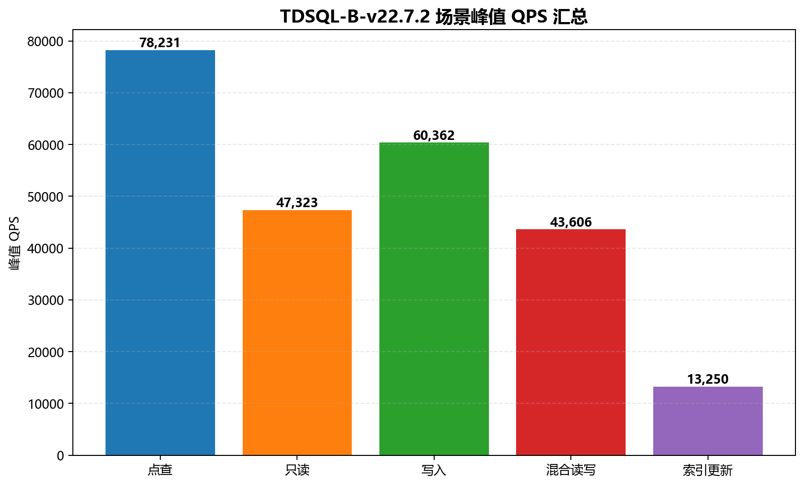
*图：TDSQL-B-v22.7.2 各独立场景的峰值 QPS；柱上标签四舍五入，精确数值见表*

> ✅ L1 | 数据来源：analysis_results.single_product.TDSQL-B-v22.7.2.scenario_stats.oltp_point_select
>
> 点查（oltp_point_select）：32→1,000 并发，QPS 从 18,420.50 升至峰值 78,230.60（峰值/起点 4.25 倍，512 并发）；最高并发 QPS 为 75,100.20，相对峰值 -4.00%。

> ✅ L1 | 数据来源：analysis_results.single_product.TDSQL-B-v22.7.2.scenario_stats.oltp_read_only
>
> 只读（oltp_read_only）：32→1,000 并发，QPS 从 11,484.20 升至峰值 47,322.80（峰值/起点 4.12 倍，512 并发）；最高并发 QPS 为 45,088.40，相对峰值 -4.72%。

> ✅ L1 | 数据来源：analysis_results.single_product.TDSQL-B-v22.7.2.scenario_stats.oltp_write_only
>
> 写入（oltp_write_only）：32→1,000 并发，QPS 从 14,460.30 升至峰值 60,362.40（峰值/起点 4.17 倍，512 并发）；最高并发 QPS 为 58,741.20，相对峰值 -2.69%。

> ✅ L1 | 数据来源：analysis_results.single_product.TDSQL-B-v22.7.2.scenario_stats.oltp_read_write
>
> 混合读写（oltp_read_write）：32→1,000 并发，QPS 从 10,408.00 升至峰值 43,606.00（峰值/起点 4.19 倍，512 并发）；最高并发 QPS 为 41,016.00，相对峰值 -5.94%。

> ✅ L1 | 数据来源：analysis_results.single_product.TDSQL-B-v22.7.2.scenario_stats.oltp_update_index
>
> 索引更新（oltp_update_index）：32→1,000 并发，QPS 从 3,120.50 升至峰值 13,250.40（峰值/起点 4.25 倍，512 并发）；最高并发 QPS 为 12,820.10，相对峰值 -3.25%。

# 第 2 章 测试环境

## 2.1 数据库配置

| 项 | 源日志值 |
| --- | --- |
| 产品及版本 | TDSQL-B-v22.7.2 |
| 测试起始时间 | 2026-06-10 14:00:00 |
| DB 端点 | 10.0.0.11:3306 |
| 数据集 | tables=16, table_size=1000000, prepare=true |
| 测试时长 | 300s（Duration: 300s） |
| 报告生成时间 | 2026-06-19T16:00:00+08:00（任务固定时间） |

## 2.2 硬件环境

源日志未提供 CPU、内存、存储、网络、操作系统以及数据库运行参数；上述信息均记为未提供，不能据此判断硬件容量或资源瓶颈。

## 2.3 测试方法

工具为 sysbench，工具版本未提供。并发档完整保留为 [32, 64, 128, 256, 512, 1000]，日志统一标注测试时长 300s。TPS 为事务每秒，QPS 为查询每秒，P95/P99 分别为第 95/99 百分位延迟（ms）。

| 场景字段 | 说明 |
| --- | --- |
| oltp_point_select | 点查 |
| oltp_read_only | 只读 |
| oltp_write_only | 写入 |
| oltp_read_write | 混合读写 |
| oltp_update_index | 索引更新 |

各场景具有不同事务组成，不能据场景间 QPS 大小直接判定业务优劣。源文件是汇总日志，没有提供完整 sysbench 命令、预热规则和重复测试轮次。

## 2.4 数据质量与公平性

| 检查项 | 结果 |
| --- | --- |
| 记录数与覆盖 | 1 产品 × 5 场景 × 6 并发档 = 30 条；无重复、无缺档 |
| TPS / QPS / P95 / P99 空值率 | 0% / 0% / 0% / 0% |
| 原始指标核对 | 30 条 × 4 项指标逐项核对一致，保留两位小数 |
| 数据来源 | data/single.log |
| 数据集与时长 | 单一日志头，全场景使用同一数据集和 Duration 标注 |
| 公平性范围 | 单产品报告；无跨产品公平性结论；硬件环境未提供（WEAK） |

测试时区未在日志注明，保留原始时间，不进行时区换算。记录中的时刻为源日志逐项标记，不推算实际结束时间或整轮总耗时。

# 第 3 章 全量测试数据

产品：TDSQL-B-v22.7.2。每条记录的测试时长均保留为日志头标注的 300s。以下为全部 30 条记录；TPS/QPS 保留两位小数与千分位，P95/P99 单位为 ms。

| 场景 | 并发 | 原始时刻 | TPS | QPS | P95 (ms) | P99 (ms) |
| --- | --- | --- | --- | --- | --- | --- |
| oltp_point_select | 32 | 14:00:00 | 18,420.50 | 18,420.50 | 2.10 | 3.40 |
| oltp_point_select | 64 | 14:05:00 | 32,150.80 | 32,150.80 | 2.40 | 3.90 |
| oltp_point_select | 128 | 14:10:00 | 58,320.40 | 58,320.40 | 2.85 | 4.60 |
| oltp_point_select | 256 | 14:15:00 | 72,450.10 | 72,450.10 | 4.80 | 8.20 |
| oltp_point_select | 512 | 14:20:00 | 78,230.60 | 78,230.60 | 8.90 | 15.40 |
| oltp_point_select | 1,000 | 14:25:00 | 75,100.20 | 75,100.20 | 18.20 | 32.10 |
| oltp_read_only | 32 | 14:30:00 | 820.30 | 11,484.20 | 42.10 | 58.30 |
| oltp_read_only | 64 | 14:35:00 | 1,480.50 | 20,727.00 | 46.50 | 64.20 |
| oltp_read_only | 128 | 14:40:00 | 2,410.80 | 33,751.20 | 58.90 | 82.40 |
| oltp_read_only | 256 | 14:45:00 | 3,120.40 | 43,685.60 | 85.30 | 120.80 |
| oltp_read_only | 512 | 14:50:00 | 3,380.20 | 47,322.80 | 158.40 | 224.50 |
| oltp_read_only | 1,000 | 14:55:00 | 3,220.60 | 45,088.40 | 320.10 | 458.20 |
| oltp_write_only | 32 | 15:30:00 | 4,820.10 | 14,460.30 | 8.40 | 14.20 |
| oltp_write_only | 64 | 15:35:00 | 8,650.40 | 25,951.20 | 9.80 | 16.50 |
| oltp_write_only | 128 | 15:40:00 | 14,820.60 | 44,461.80 | 12.40 | 21.30 |
| oltp_write_only | 256 | 15:45:00 | 18,950.20 | 56,850.60 | 18.20 | 32.40 |
| oltp_write_only | 512 | 15:50:00 | 20,120.80 | 60,362.40 | 32.50 | 58.20 |
| oltp_write_only | 1,000 | 15:55:00 | 19,580.40 | 58,741.20 | 68.40 | 124.30 |
| oltp_read_write | 32 | 15:00:00 | 520.40 | 10,408.00 | 72.30 | 98.50 |
| oltp_read_write | 64 | 15:05:00 | 940.20 | 18,804.00 | 78.50 | 110.20 |
| oltp_read_write | 128 | 15:10:00 | 1,560.80 | 31,216.00 | 92.10 | 132.40 |
| oltp_read_write | 256 | 15:15:00 | 2,010.50 | 40,210.00 | 138.40 | 198.30 |
| oltp_read_write | 512 | 15:20:00 | 2,180.30 | 43,606.00 | 248.20 | 358.10 |
| oltp_read_write | 1,000 | 15:25:00 | 2,050.80 | 41,016.00 | 512.30 | 748.40 |
| oltp_update_index | 32 | 16:00:00 | 3,120.50 | 3,120.50 | 12.80 | 20.40 |
| oltp_update_index | 64 | 16:05:00 | 5,640.20 | 5,640.20 | 14.20 | 23.10 |
| oltp_update_index | 128 | 16:10:00 | 9,820.40 | 9,820.40 | 17.50 | 29.80 |
| oltp_update_index | 256 | 16:15:00 | 12,480.80 | 12,480.80 | 24.60 | 42.30 |
| oltp_update_index | 512 | 16:20:00 | 13,250.40 | 13,250.40 | 42.80 | 72.50 |
| oltp_update_index | 1,000 | 16:25:00 | 12,820.10 | 12,820.10 | 88.40 | 152.30 |

# 第 4 章 性能分析

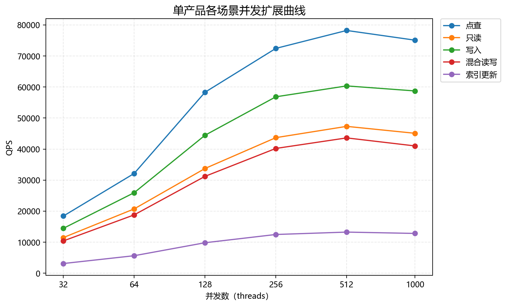
*图：TDSQL-B-v22.7.2 各场景独立 QPS 曲线（不作均值或综合评分）*

## 4.1 点查（oltp_point_select）

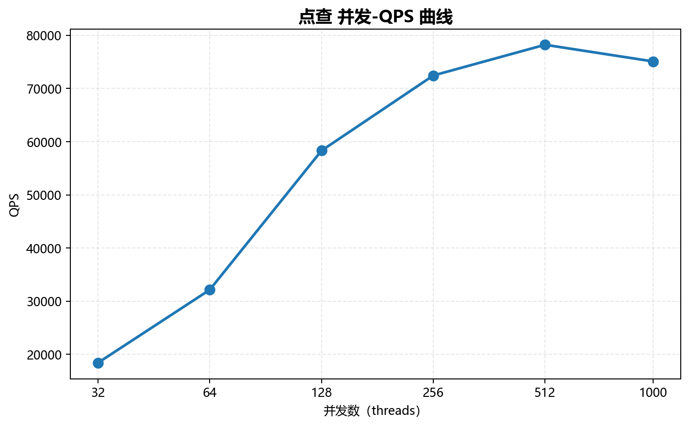
*图：点查 并发-QPS 曲线；横轴为以 2 为底的对数刻度，覆盖全部并发档*

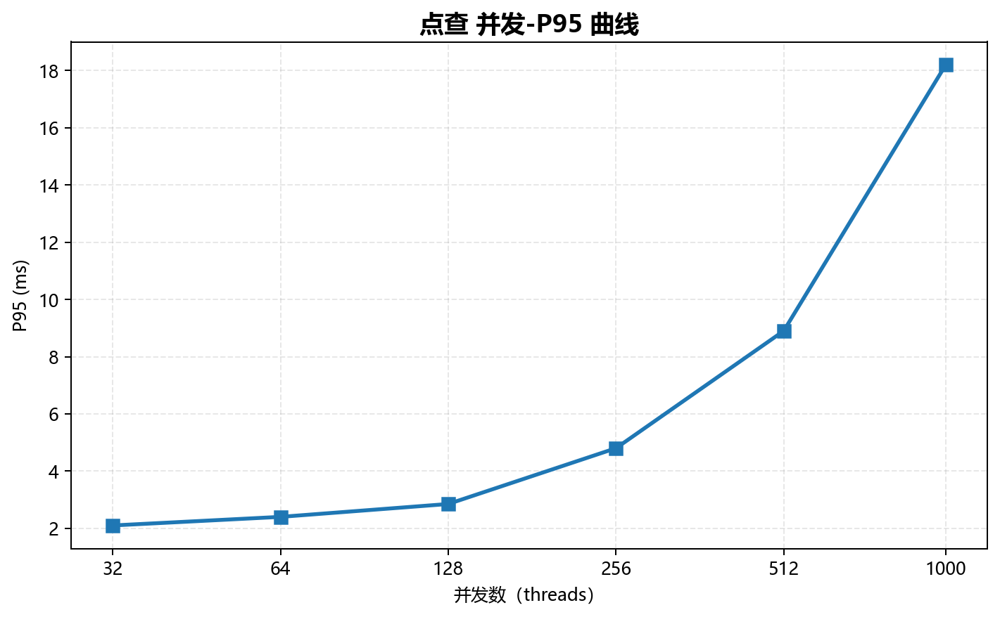
*图：点查 并发-P95 曲线；横轴为以 2 为底的对数刻度，覆盖全部并发档*

> ✅ L1 | 数据来源：analysis_results.single_product.TDSQL-B-v22.7.2.scenario_stats.oltp_point_select
>
> 点查（oltp_point_select）：32→1,000 并发，QPS 从 18,420.50 升至峰值 78,230.60（峰值/起点 4.25 倍，512 并发）；最高并发 QPS 为 75,100.20，相对峰值 -4.00%。

延迟稳定性：从 32 到 1,000 并发，P95 2.10→18.20 ms，P99 3.40→32.10 ms；最高并发的 P95 为峰值 QPS 档位的 2.04 倍。未提供延迟 SLA，故不判定达标与否。

## 4.2 只读（oltp_read_only）

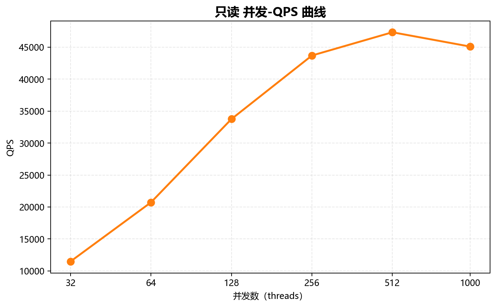
*图：只读 并发-QPS 曲线；横轴为以 2 为底的对数刻度，覆盖全部并发档*

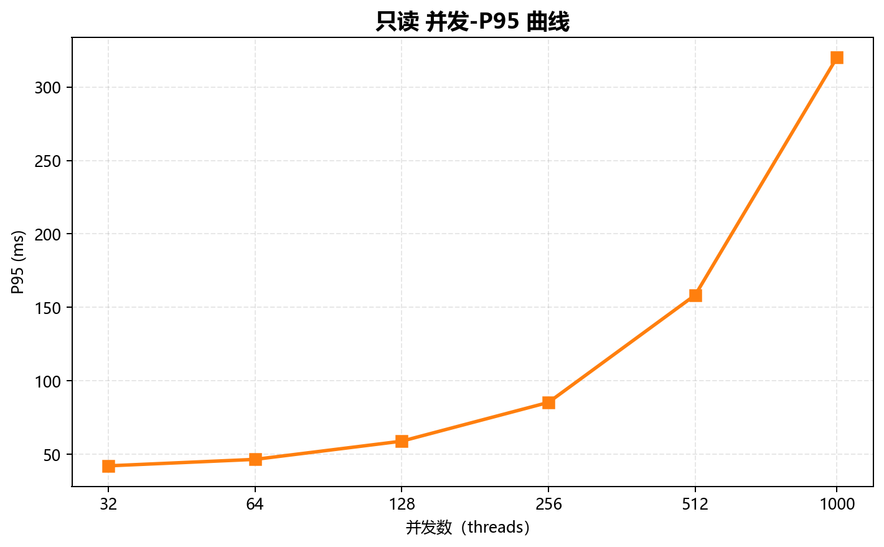
*图：只读 并发-P95 曲线；横轴为以 2 为底的对数刻度，覆盖全部并发档*

> ✅ L1 | 数据来源：analysis_results.single_product.TDSQL-B-v22.7.2.scenario_stats.oltp_read_only
>
> 只读（oltp_read_only）：32→1,000 并发，QPS 从 11,484.20 升至峰值 47,322.80（峰值/起点 4.12 倍，512 并发）；最高并发 QPS 为 45,088.40，相对峰值 -4.72%。

延迟稳定性：从 32 到 1,000 并发，P95 42.10→320.10 ms，P99 58.30→458.20 ms；最高并发的 P95 为峰值 QPS 档位的 2.02 倍。未提供延迟 SLA，故不判定达标与否。

## 4.3 写入（oltp_write_only）

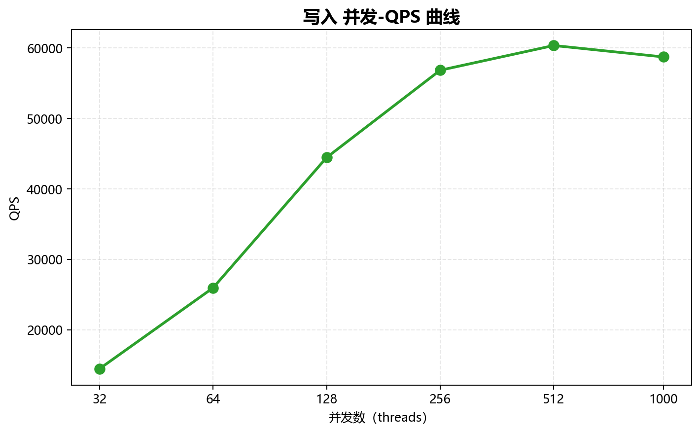
*图：写入 并发-QPS 曲线；横轴为以 2 为底的对数刻度，覆盖全部并发档*

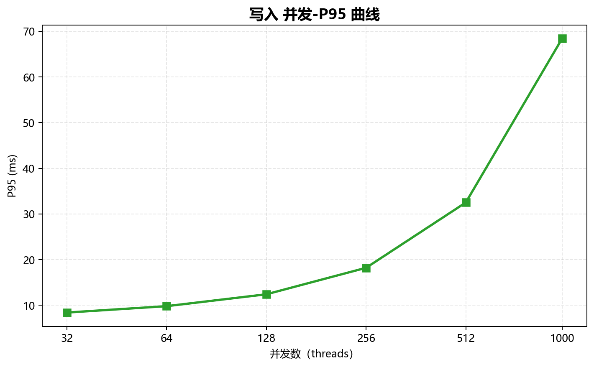
*图：写入 并发-P95 曲线；横轴为以 2 为底的对数刻度，覆盖全部并发档*

> ✅ L1 | 数据来源：analysis_results.single_product.TDSQL-B-v22.7.2.scenario_stats.oltp_write_only
>
> 写入（oltp_write_only）：32→1,000 并发，QPS 从 14,460.30 升至峰值 60,362.40（峰值/起点 4.17 倍，512 并发）；最高并发 QPS 为 58,741.20，相对峰值 -2.69%。

延迟稳定性：从 32 到 1,000 并发，P95 8.40→68.40 ms，P99 14.20→124.30 ms；最高并发的 P95 为峰值 QPS 档位的 2.10 倍。未提供延迟 SLA，故不判定达标与否。

## 4.4 混合读写（oltp_read_write）

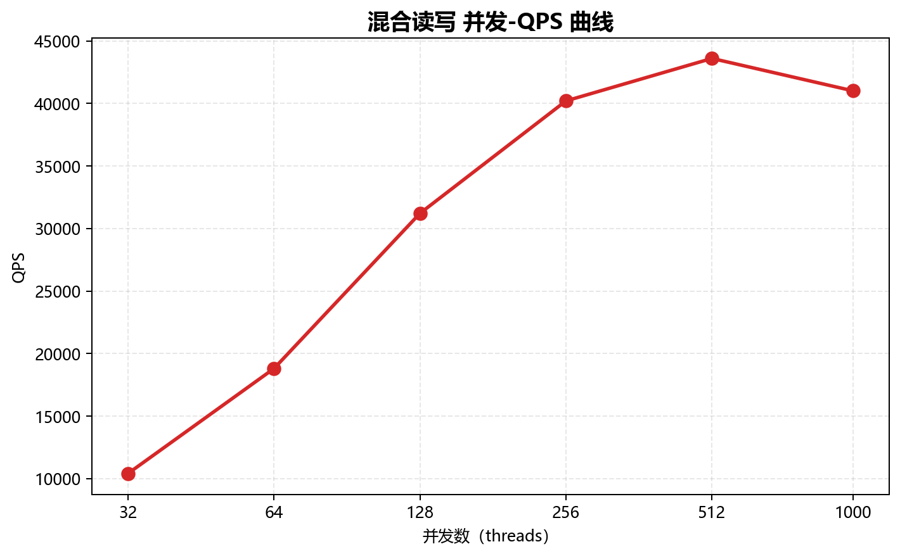
*图：混合读写 并发-QPS 曲线；横轴为以 2 为底的对数刻度，覆盖全部并发档*

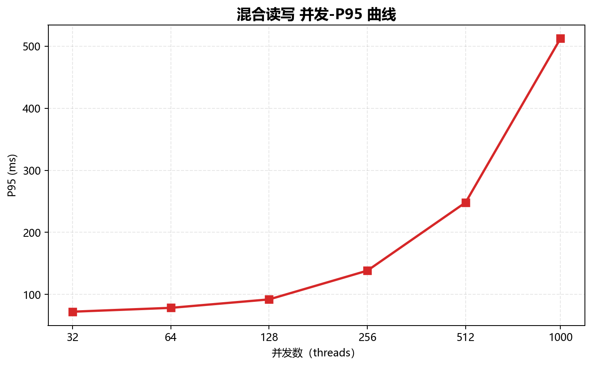
*图：混合读写 并发-P95 曲线；横轴为以 2 为底的对数刻度，覆盖全部并发档*

> ✅ L1 | 数据来源：analysis_results.single_product.TDSQL-B-v22.7.2.scenario_stats.oltp_read_write
>
> 混合读写（oltp_read_write）：32→1,000 并发，QPS 从 10,408.00 升至峰值 43,606.00（峰值/起点 4.19 倍，512 并发）；最高并发 QPS 为 41,016.00，相对峰值 -5.94%。

> 📊 L2 | 数据来源：analysis_results.single_product.TDSQL-B-v22.7.2.scenario_stats.oltp_read_write
>
> 混合读写在 512 并发后出现已测档位的性能拐点：1,000 并发 QPS 较峰值下降 5.94%（超过 5% 判据）。该发现不代表已定位瓶颈原因。

延迟稳定性：从 32 到 1,000 并发，P95 72.30→512.30 ms，P99 98.50→748.40 ms；最高并发的 P95 为峰值 QPS 档位的 2.06 倍。未提供延迟 SLA，故不判定达标与否。

## 4.5 索引更新（oltp_update_index）

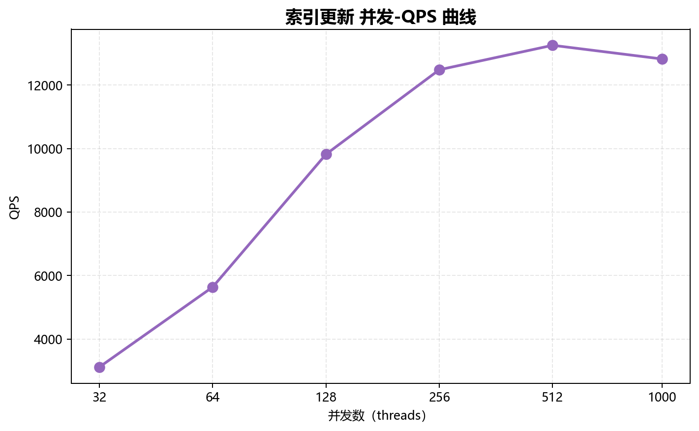
*图：索引更新 并发-QPS 曲线；横轴为以 2 为底的对数刻度，覆盖全部并发档*

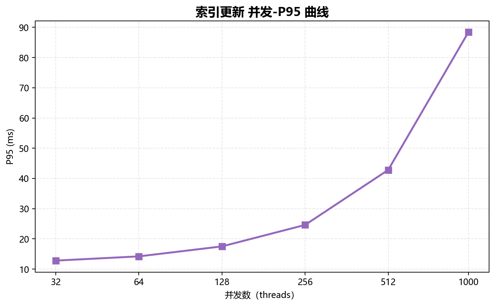
*图：索引更新 并发-P95 曲线；横轴为以 2 为底的对数刻度，覆盖全部并发档*

> ✅ L1 | 数据来源：analysis_results.single_product.TDSQL-B-v22.7.2.scenario_stats.oltp_update_index
>
> 索引更新（oltp_update_index）：32→1,000 并发，QPS 从 3,120.50 升至峰值 13,250.40（峰值/起点 4.25 倍，512 并发）；最高并发 QPS 为 12,820.10，相对峰值 -3.25%。

延迟稳定性：从 32 到 1,000 并发，P95 12.80→88.40 ms，P99 20.40→152.30 ms；最高并发的 P95 为峰值 QPS 档位的 2.07 倍。未提供延迟 SLA，故不判定达标与否。

# 第 5 章 优化建议

## 5.1 后续验证与调优建议

全部场景的已测 QPS 峰值位于 512 并发。建议在该档位附近补充测试并发点，并结合业务延迟目标选择并发上限；本次数据不足以直接给出生产连接池上限。

建议在保持现有数据集与时长一致的条件下重复测试，并同步记录 CPU、内存、磁盘、锁等待及缓存命中数据，再判断吞吐回落原因。没有资源观测数据，不给出具体 Buffer Pool 比例或未经验证的数据库参数。

## 5.2 测试边界

仅覆盖本日志的 TDSQL-B-v22.7.2、单一数据集、5 个场景和 6 个并发档。未提供重复测试、误差范围、资源监控或线上业务验证数据；结论仅描述已测档位。

本报告不补造缺失数据，不由尾延迟变化推断具体瓶颈，也不把单次基准结果外推为生产容量或持续稳定性保证。

# 第 6 章 附录

## 6.1 附录 A：sysbench 命令与原始头部

完整 sysbench 命令未提供。下表逐行保留原始日志头，不据汇总信息拼造执行命令。

| 原始头部行 |
| --- |
| Sysbench oltp Test |
| Time: 2026-06-10 14:00:00 |
| DB: TDSQL-B-v22.7.2 host=10.0.0.11:3306 |
| Data: tables=16, table_size=1000000, prepare=true |
| Threads: 32 64 128 256 512 1000 |
| Duration: 300s |

## 6.2 附录 B：来源与复核方法

| 项 | 值 |
| --- | --- |
| 原始文件 | data/single.log |
| SHA-256 | 68ca345e661ff759202571c9f87d2f7f817523b8a762db5ee874b7edf2443ea5 |
| 标准化数据 | data/extracted_data.json（相对报告目录） |
| 分析与洞察 | data/analysis_results.json；data/insights.json |
| 图表 | charts/，共 12 张 |
| 逐条来源 | 标准化 records 中的 source_line 和 sample_time 对应原日志行号与时刻 |

计算方法：各场景独立取 max(QPS) 为已测峰值；扩展倍数 = 峰值 QPS / 最低并发 QPS；最高并发相对峰值变化 = (最高并发 QPS / 峰值 QPS − 1) × 100%。只有峰值出现在最高并发之前且最高并发 QPS 低于峰值的 95% 时标注 L2 拐点。

L1 表示 Python 计算的客观事实，L2 表示统计发现。报告未加入 L3 原因推测。所有原始性能数据均来自原日志，补充环境信息明确注明未提供。
