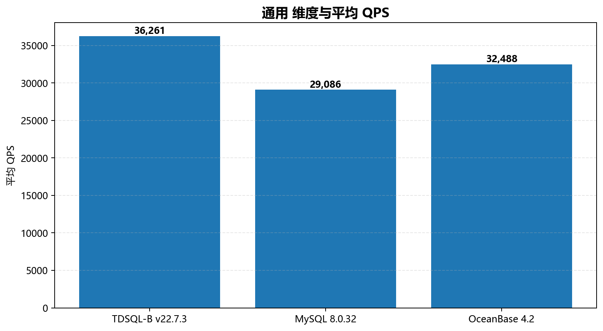
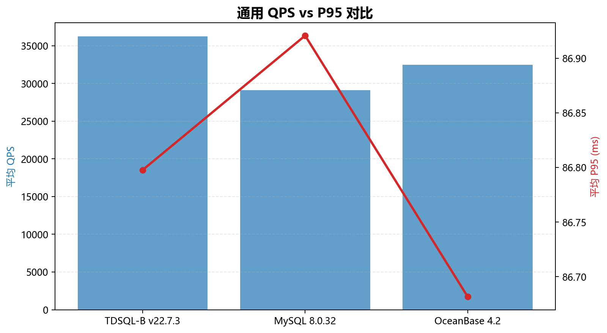

# None 专项报告

> 数据库性能客制化分析

- **日期**：2026-06-16
- **版本**：v1.0

---

## 目录

- [第 1 章 分析目标](#第-1-章-分析目标)
  - [1.1 分析说明](#11-分析说明)
  - [1.2 数据范围](#12-数据范围)
- [第 2 章 深度分析](#第-2-章-深度分析)
  - [2.1 None 分桶分析](#21-none-分桶分析)
- [第 3 章 结论与建议](#第-3-章-结论与建议)
  - [3.1 核心发现](#31-核心发现)
  - [3.2 建议与后续](#32-建议与后续)

---

## 第 1 章 分析目标

### 1.1 分析说明

针对 None 维度的深度分析

### 1.2 数据范围

| 项 | 值 |
| --- | --- |
| 产品 | TDSQL-B v22.7.3、MySQL 8.0.32、OceanBase 4.2 |
| 场景 | 点查、只读、混合读写、写入、索引更新 |
| 记录数 | 90 条 |
| 数据来源 | test-resource/mock_records_aggregation.json |

## 第 2 章 深度分析

### 2.1 None 分桶分析

按 None 分桶后，各桶平均性能如下：

| 分桶 | 平均 QPS | 平均 P95 (ms) | 样本数 |
| --- | --- | --- | --- |
| TDSQL-B v22.7.3 | 36,261 | 86.80 | 30 |
| MySQL 8.0.32 | 29,086 | 86.92 | 30 |
| OceanBase 4.2 | 32,488 | 86.68 | 30 |

*None 维度与平均 QPS*

*None QPS vs P95 对比*

> **[L1]** TDSQL-B v22.7.3 峰值 QPS 最高出现在 oltp_point_select（89,929 @ 512 并发）

> **[L1]** TDSQL-B v22.7.3 峰值 QPS 最低出现在 oltp_update_index（14,747 @ 512 并发）

> **[L1]** oltp_point_select 并发扩展率 +334.0%（32→1000 threads）

> **[L1]** oltp_read_only 并发扩展率 +323.6%（32→1000 threads）

> **[L1]** oltp_read_write 并发扩展率 +324.0%（32→1000 threads）

> **[L1]** oltp_write_only 并发扩展率 +325.0%（32→1000 threads）

> **[L1]** oltp_update_index 并发扩展率 +326.6%（32→1000 threads）

> **[L1]** MySQL 8.0.32 峰值 QPS 最高出现在 oltp_point_select（71,646 @ 512 并发）

> **[L1]** MySQL 8.0.32 峰值 QPS 最低出现在 oltp_update_index（12,010 @ 512 并发）

> **[L1]** oltp_point_select 并发扩展率 +318.9%（32→1000 threads）

> **[L1]** oltp_read_only 并发扩展率 +330.2%（32→1000 threads）

> **[L1]** oltp_read_write 并发扩展率 +329.9%（32→1000 threads）

> **[L1]** oltp_write_only 并发扩展率 +326.1%（32→1000 threads）

> **[L1]** oltp_update_index 并发扩展率 +328.2%（32→1000 threads）

> **[L1]** OceanBase 4.2 峰值 QPS 最高出现在 oltp_point_select（79,642 @ 512 并发）

> **[L1]** OceanBase 4.2 峰值 QPS 最低出现在 oltp_update_index（13,058 @ 512 并发）

> **[L1]** oltp_point_select 并发扩展率 +331.6%（32→1000 threads）

> **[L1]** oltp_read_only 并发扩展率 +325.3%（32→1000 threads）

> **[L1]** oltp_read_write 并发扩展率 +330.6%（32→1000 threads）

> **[L1]** oltp_write_only 并发扩展率 +328.3%（32→1000 threads）

> **[L1]** oltp_update_index 并发扩展率 +326.4%（32→1000 threads）

> **[L2]** 已按产品分桶输出平均 QPS / P95，详见分析章节。

## 第 3 章 结论与建议

### 3.1 核心发现

> **[L2]** 已按产品分桶输出平均 QPS / P95，详见分析章节。

### 3.2 建议与后续

- 本报告聚焦 None 维度，建议结合实际业务场景做进一步验证。
- 如需扩展分析维度，可在门控①阶段补充需求。
- 数据可能存在采集条件差异，请在结论中标注不确定性。
