# 数据库性能对比报告

> TDSQL-B v22.7.3 vs MySQL 8.0.32 vs OceanBase 4.2

- **日期**：2026-06-19
- **版本**：v1.0

---

## 目录

- [第 1 章 测试结论](#第-1-章-测试结论)
- [第 2 章 环境与公平性](#第-2-章-环境与公平性)
  - [2.1 测试批次与数据集](#21-测试批次与数据集)
  - [2.2 硬件与公平性限制](#22-硬件与公平性限制)
  - [2.3 数据质量](#23-数据质量)
- [第 3 章 全量性能数据](#第-3-章-全量性能数据)
  - [3.1 TDSQL-B v22.7.3](#31-tdsql-b-v2273)
  - [3.2 MySQL 8.0.32](#32-mysql-8032)
  - [3.3 OceanBase 4.2](#33-oceanbase-42)
- [第 4 章 按场景横向对比](#第-4-章-按场景横向对比)
  - [4.1 点查（oltp_point_select）](#41-点查oltppointselect)
  - [4.2 只读（oltp_read_only）](#42-只读oltpreadonly)
  - [4.3 读写（oltp_read_write）](#43-读写oltpreadwrite)
  - [4.4 写入（oltp_write_only）](#44-写入oltpwriteonly)
  - [4.5 更新索引（oltp_update_index）](#45-更新索引oltpupdateindex)
  - [4.6 峰值QPS比值矩阵](#46-峰值qps比值矩阵)
  - [4.7 单产品并发曲线](#47-单产品并发曲线)
- [第 5 章 选型建议与边界](#第-5-章-选型建议与边界)
  - [5.1 选型建议](#51-选型建议)
  - [5.2 测试边界](#52-测试边界)
- [第 6 章 附录](#第-6-章-附录)
  - [6.1 数据来源](#61-数据来源)

---

## 第 1 章 测试结论

本报告对比 3 个产品、5 个场景及 90 条记录。数据集配置、测试时长、场景和并发档对齐；公平性存在 STRONG 限制，结论仅为描述性比较。

| 场景 | 第一名 | 峰值QPS | 峰值并发 | 第二名 | 第二名QPS | 第三名 |
| --- | --- | --- | --- | --- | --- | --- |
| 点查 | TDSQL-B v22.7.3 | 89,929 | 512 | OceanBase 4.2 | 79,642 | MySQL 8.0.32 |
| 只读 | TDSQL-B v22.7.3 | 52,087 | 512 | OceanBase 4.2 | 46,373 | MySQL 8.0.32 |
| 读写 | TDSQL-B v22.7.3 | 36,054 | 512 | OceanBase 4.2 | 33,315 | MySQL 8.0.32 |
| 写入 | TDSQL-B v22.7.3 | 67,175 | 512 | OceanBase 4.2 | 60,428 | MySQL 8.0.32 |
| 更新索引 | TDSQL-B v22.7.3 | 14,747 | 512 | OceanBase 4.2 | 13,058 | MySQL 8.0.32 |

> **[L1]** 点查峰值QPS排序：TDSQL-B v22.7.3 > OceanBase 4.2 > MySQL 8.0.32；第一名较第二名高12.9%。

> **[L1]** 只读峰值QPS排序：TDSQL-B v22.7.3 > OceanBase 4.2 > MySQL 8.0.32；第一名较第二名高12.3%。

> **[L1]** 读写峰值QPS排序：TDSQL-B v22.7.3 > OceanBase 4.2 > MySQL 8.0.32；第一名较第二名高8.2%。

> **[L1]** 写入峰值QPS排序：TDSQL-B v22.7.3 > OceanBase 4.2 > MySQL 8.0.32；第一名较第二名高11.2%。

> **[L1]** 更新索引峰值QPS排序：TDSQL-B v22.7.3 > OceanBase 4.2 > MySQL 8.0.32；第一名较第二名高12.9%。

## 第 2 章 环境与公平性

### 2.1 测试批次与数据集

| 产品 | 引擎 | 开始时间 | 时长秒 | 数据配置 | 任务ID |
| --- | --- | --- | --- | --- | --- |
| TDSQL-B v22.7.3 | sysbench | 2026-06-11 09:30:00 | 300 | tables=16, table_size=1000000 | aa112233_tdsql_intel_x86 |
| MySQL 8.0.32 | sysbench | 2026-06-11 13:30:00 | 300 | tables=16, table_size=1000000 | bb445566_mysql_intel_x86 |
| OceanBase 4.2 | sysbench | 2026-06-11 17:30:00 | 300 | tables=16, table_size=1000000 | cc778899_ob_intel_x86 |

三产品均为 tables=16、table_size=1,000,000，运行 300 秒；覆盖同五场景及 32、64、128、256、512、1000 并发。

### 2.2 硬件与公平性限制

| 环境项 | 声明 |
| --- | --- |
| CPU | Intel(R) Xeon(R) Gold 6133 @ 2.50GHz, 64 cores |
| Memory | 256GB DDR4 |
| Disk | NVMe SSD 3.84TB |
| Network | 25Gbps |
| OS | TencentOS Server 3.1 |
| sysbench_version | 1.0.20 |

公平性限制（STRONG）：测试分别在 09:30、13:30、17:30 开始，且 task_id 不同，非同步同批次交叉测试；元数据仅有共享硬件声明，未提供逐产品主机及资源分配核验；未提供逐产品数据库配置和资源配额，无法确认除产品外变量完全相同；每个产品只有一轮结果，缺少重复运行、预热和波动范围

- 测试分别在 09:30、13:30、17:30 开始，且 task_id 不同，非同步同批次交叉测试
- 元数据仅有共享硬件声明，未提供逐产品主机及资源分配核验
- 未提供逐产品数据库配置和资源配额，无法确认除产品外变量完全相同
- 每个产品只有一轮结果，缺少重复运行、预热和波动范围

### 2.3 数据质量

来源 test-resource/mock_records_aggregation.json；90 条记录，TPS/QPS/P95/P99 均有值。输入为汇总数据，不含原始 sysbench 日志。

## 第 3 章 全量性能数据

### 3.1 TDSQL-B v22.7.3

| 场景 | 并发 | TPS | QPS | P95 ms | P99 ms |
| --- | --- | --- | --- | --- | --- |
| 点查 | 32 | 19,494.95 | 19,494.95 | 1.14 | 1.64 |
| 点查 | 64 | 34,925.66 | 34,925.66 | 1.39 | 2.00 |
| 点查 | 128 | 63,461.25 | 63,461.25 | 2.52 | 3.58 |
| 点查 | 256 | 82,178.62 | 82,178.62 | 4.25 | 6.10 |
| 点查 | 512 | 89,928.71 | 89,928.71 | 7.95 | 11.41 |
| 点查 | 1000 | 84,599.90 | 84,599.90 | 15.62 | 21.71 |
| 只读 | 32 | 828.61 | 11,600.60 | 24.28 | 32.80 |
| 只读 | 64 | 1,458.11 | 20,413.59 | 29.61 | 42.40 |
| 只读 | 128 | 2,676.63 | 37,472.87 | 54.35 | 76.63 |
| 只读 | 256 | 3,515.52 | 49,217.26 | 88.54 | 123.43 |
| 只读 | 512 | 3,720.49 | 52,086.84 | 163.74 | 236.25 |
| 只读 | 1000 | 3,510.42 | 49,145.88 | 330.30 | 460.76 |
| 读写 | 32 | 398.73 | 7,974.60 | 52.26 | 74.48 |
| 读写 | 64 | 717.34 | 14,346.84 | 64.15 | 92.98 |
| 读写 | 128 | 1,291.52 | 25,830.30 | 114.76 | 155.59 |
| 读写 | 256 | 1,684.73 | 33,694.61 | 187.47 | 260.10 |
| 读写 | 512 | 1,802.69 | 36,053.83 | 364.41 | 523.22 |
| 读写 | 1000 | 1,690.58 | 33,811.66 | 732.19 | 999.62 |
| 写入 | 32 | 4,873.50 | 14,620.51 | 5.34 | 7.70 |
| 写入 | 64 | 8,617.85 | 25,853.55 | 6.46 | 9.31 |
| 写入 | 128 | 15,818.31 | 47,454.94 | 11.78 | 16.72 |
| 写入 | 256 | 20,790.68 | 62,372.04 | 19.54 | 28.18 |
| 写入 | 512 | 22,391.81 | 67,175.43 | 36.92 | 51.88 |
| 写入 | 1000 | 20,713.72 | 62,141.15 | 73.08 | 102.59 |
| 更新索引 | 32 | 3,273.38 | 3,273.38 | 7.25 | 10.05 |
| 更新索引 | 64 | 5,830.92 | 5,830.92 | 8.94 | 12.70 |
| 更新索引 | 128 | 10,598.84 | 10,598.84 | 16.25 | 22.76 |
| 更新索引 | 256 | 13,567.85 | 13,567.85 | 27.60 | 37.76 |
| 更新索引 | 512 | 14,746.99 | 14,746.99 | 50.85 | 71.63 |
| 更新索引 | 1000 | 13,965.57 | 13,965.57 | 100.99 | 137.41 |

### 3.2 MySQL 8.0.32

| 场景 | 并发 | TPS | QPS | P95 ms | P99 ms |
| --- | --- | --- | --- | --- | --- |
| 点查 | 32 | 16,074.87 | 16,074.87 | 1.16 | 1.64 |
| 点查 | 64 | 28,323.44 | 28,323.44 | 1.39 | 1.92 |
| 点查 | 128 | 51,088.25 | 51,088.25 | 2.54 | 3.59 |
| 点查 | 256 | 66,856.78 | 66,856.78 | 4.26 | 5.85 |
| 点查 | 512 | 71,646.19 | 71,646.19 | 7.99 | 11.33 |
| 点查 | 1000 | 67,337.58 | 67,337.58 | 15.89 | 22.27 |
| 只读 | 32 | 651.85 | 9,125.96 | 24.03 | 32.93 |
| 只读 | 64 | 1,177.93 | 16,491.00 | 29.61 | 40.50 |
| 只读 | 128 | 2,099.20 | 29,388.81 | 54.17 | 73.19 |
| 只读 | 256 | 2,761.20 | 38,656.85 | 86.59 | 122.84 |
| 只读 | 512 | 2,940.55 | 41,167.67 | 166.22 | 227.19 |
| 只读 | 1000 | 2,804.41 | 39,261.75 | 332.48 | 463.32 |
| 读写 | 32 | 331.28 | 6,625.69 | 53.05 | 72.02 |
| 读写 | 64 | 588.92 | 11,778.34 | 63.01 | 85.92 |
| 读写 | 128 | 1,087.87 | 21,757.36 | 116.14 | 164.18 |
| 读写 | 256 | 1,387.86 | 27,757.19 | 188.54 | 262.82 |
| 读写 | 512 | 1,501.03 | 30,020.65 | 363.68 | 525.48 |
| 读写 | 1000 | 1,424.25 | 28,484.97 | 731.16 | 1,057.62 |
| 写入 | 32 | 3,865.91 | 11,597.72 | 5.23 | 7.52 |
| 写入 | 64 | 6,942.02 | 20,826.05 | 6.39 | 8.98 |
| 写入 | 128 | 12,480.43 | 37,441.30 | 11.60 | 16.12 |
| 写入 | 256 | 16,295.91 | 48,887.74 | 19.12 | 26.79 |
| 写入 | 512 | 17,417.06 | 52,251.17 | 36.16 | 51.07 |
| 写入 | 1000 | 16,471.39 | 49,414.16 | 73.64 | 100.31 |
| 更新索引 | 32 | 2,652.17 | 2,652.17 | 7.29 | 10.11 |
| 更新索引 | 64 | 4,731.63 | 4,731.63 | 9.00 | 12.90 |
| 更新索引 | 128 | 8,501.76 | 8,501.76 | 16.09 | 21.76 |
| 更新索引 | 256 | 11,060.74 | 11,060.74 | 26.82 | 37.02 |
| 更新索引 | 512 | 12,009.86 | 12,009.86 | 50.95 | 72.89 |
| 更新索引 | 1000 | 11,356.38 | 11,356.38 | 103.42 | 148.48 |

### 3.3 OceanBase 4.2

| 场景 | 并发 | TPS | QPS | P95 ms | P99 ms |
| --- | --- | --- | --- | --- | --- |
| 点查 | 32 | 17,343.76 | 17,343.76 | 1.16 | 1.60 |
| 点查 | 64 | 30,700.18 | 30,700.18 | 1.42 | 2.01 |
| 点查 | 128 | 56,880.38 | 56,880.38 | 2.59 | 3.65 |
| 点查 | 256 | 73,250.45 | 73,250.45 | 4.26 | 5.89 |
| 点查 | 512 | 79,641.75 | 79,641.75 | 7.84 | 11.24 |
| 点查 | 1000 | 74,860.15 | 74,860.15 | 15.86 | 22.39 |
| 只读 | 32 | 732.19 | 10,250.68 | 23.90 | 33.22 |
| 只读 | 64 | 1,315.13 | 18,411.79 | 29.05 | 40.85 |
| 只读 | 128 | 2,368.33 | 33,156.64 | 53.36 | 74.61 |
| 只读 | 256 | 3,104.37 | 43,461.17 | 86.63 | 120.77 |
| 只读 | 512 | 3,312.35 | 46,372.94 | 164.39 | 236.92 |
| 只读 | 1000 | 3,114.31 | 43,600.36 | 334.03 | 477.14 |
| 读写 | 32 | 362.48 | 7,249.67 | 51.57 | 72.99 |
| 读写 | 64 | 647.62 | 12,952.36 | 63.82 | 88.14 |
| 读写 | 128 | 1,181.64 | 23,632.87 | 115.64 | 163.14 |
| 读写 | 256 | 1,543.89 | 30,877.75 | 188.86 | 262.39 |
| 读写 | 512 | 1,665.76 | 33,315.16 | 359.37 | 501.07 |
| 读写 | 1000 | 1,560.91 | 31,218.13 | 731.99 | 1,031.50 |
| 写入 | 32 | 4,391.70 | 13,175.11 | 5.29 | 7.39 |
| 写入 | 64 | 7,827.30 | 23,481.89 | 6.54 | 9.37 |
| 写入 | 128 | 14,272.38 | 42,817.14 | 11.67 | 16.25 |
| 写入 | 256 | 18,632.36 | 55,897.09 | 19.50 | 28.27 |
| 写入 | 512 | 20,142.74 | 60,428.22 | 36.55 | 51.93 |
| 写入 | 1000 | 18,810.26 | 56,430.79 | 72.95 | 100.08 |
| 更新索引 | 32 | 2,890.43 | 2,890.43 | 7.29 | 10.43 |
| 更新索引 | 64 | 5,214.30 | 5,214.30 | 9.18 | 13.26 |
| 更新索引 | 128 | 9,508.19 | 9,508.19 | 16.48 | 23.53 |
| 更新索引 | 256 | 12,244.84 | 12,244.84 | 27.14 | 36.94 |
| 更新索引 | 512 | 13,057.94 | 13,057.94 | 51.43 | 70.27 |
| 更新索引 | 1000 | 12,325.56 | 12,325.56 | 100.69 | 140.96 |

## 第 4 章 按场景横向对比

### 4.1 点查（oltp_point_select）

本场景独立比较；峰值取每产品六档并发中的最大 QPS。

| 产品 | 峰值并发 | 峰值QPS | 峰值P95 | 峰值P99 |
| --- | --- | --- | --- | --- |
| TDSQL-B v22.7.3 | 512 | 89,929 | 7.95 | 11.41 |
| MySQL 8.0.32 | 512 | 71,646 | 7.99 | 11.33 |
| OceanBase 4.2 | 512 | 79,642 | 7.84 | 11.24 |

| 并发 | TDSQL-B v22.7.3 QPS | MySQL 8.0.32 QPS | OceanBase 4.2 QPS | TDSQL-B v22.7.3 P95(ms) | MySQL 8.0.32 P95(ms) | OceanBase 4.2 P95(ms) |
| --- | --- | --- | --- | --- | --- | --- |
| 32 | 19,495 | 16,075 | 17,344 | 1.14 | 1.16 | 1.16 |
| 64 | 34,926 | 28,323 | 30,700 | 1.39 | 1.39 | 1.42 |
| 128 | 63,461 | 51,088 | 56,880 | 2.52 | 2.54 | 2.59 |
| 256 | 82,179 | 66,857 | 73,250 | 4.25 | 4.26 | 4.26 |
| 512 | 89,929 | 71,646 | 79,642 | 7.95 | 7.99 | 7.84 |
| 1000 | 84,600 | 67,338 | 74,860 | 15.62 | 15.89 | 15.86 |

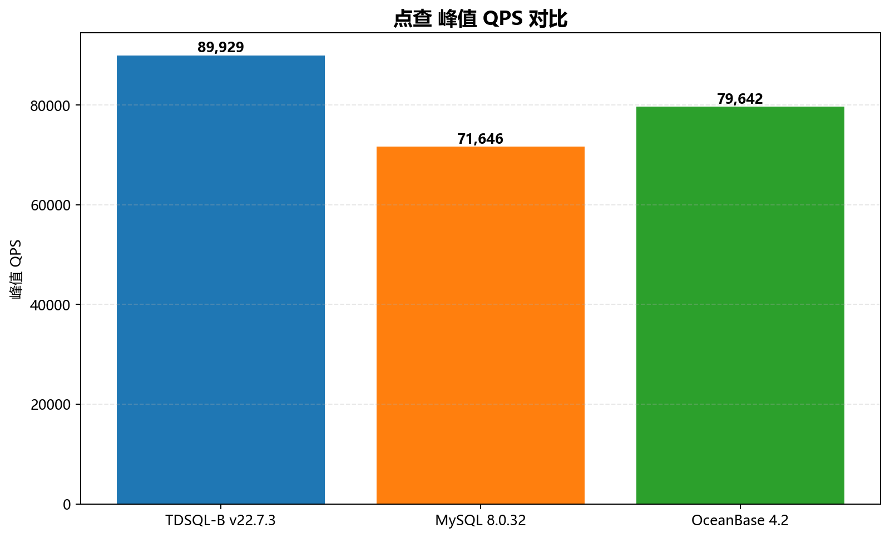
*点查峰值QPS*

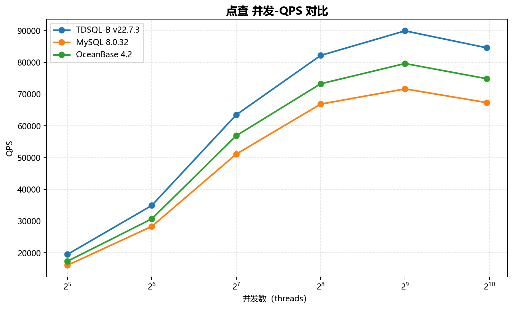
*点查并发-QPS*

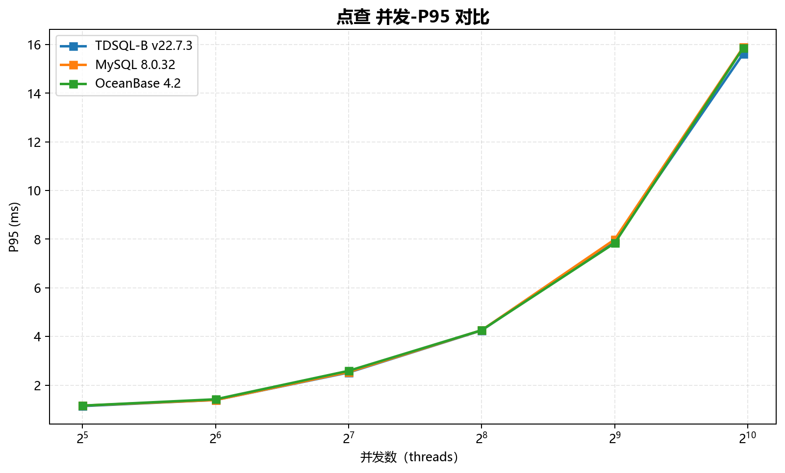
*点查并发-P95*

### 4.2 只读（oltp_read_only）

本场景独立比较；峰值取每产品六档并发中的最大 QPS。

| 产品 | 峰值并发 | 峰值QPS | 峰值P95 | 峰值P99 |
| --- | --- | --- | --- | --- |
| TDSQL-B v22.7.3 | 512 | 52,087 | 163.74 | 236.25 |
| MySQL 8.0.32 | 512 | 41,168 | 166.22 | 227.19 |
| OceanBase 4.2 | 512 | 46,373 | 164.39 | 236.92 |

| 并发 | TDSQL-B v22.7.3 QPS | MySQL 8.0.32 QPS | OceanBase 4.2 QPS | TDSQL-B v22.7.3 P95(ms) | MySQL 8.0.32 P95(ms) | OceanBase 4.2 P95(ms) |
| --- | --- | --- | --- | --- | --- | --- |
| 32 | 11,601 | 9,126 | 10,251 | 24.28 | 24.03 | 23.90 |
| 64 | 20,414 | 16,491 | 18,412 | 29.61 | 29.61 | 29.05 |
| 128 | 37,473 | 29,389 | 33,157 | 54.35 | 54.17 | 53.36 |
| 256 | 49,217 | 38,657 | 43,461 | 88.54 | 86.59 | 86.63 |
| 512 | 52,087 | 41,168 | 46,373 | 163.74 | 166.22 | 164.39 |
| 1000 | 49,146 | 39,262 | 43,600 | 330.30 | 332.48 | 334.03 |

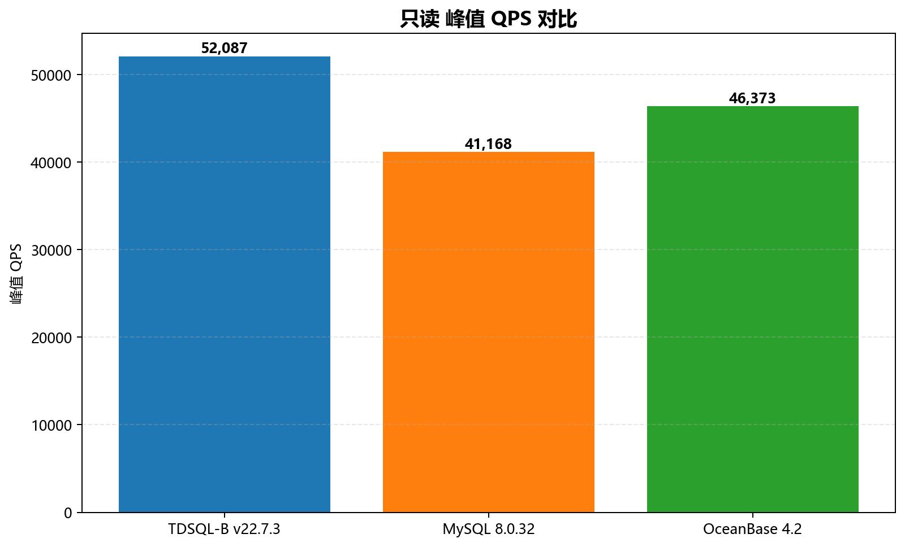
*只读峰值QPS*

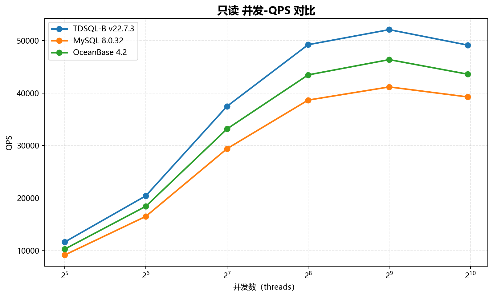
*只读并发-QPS*

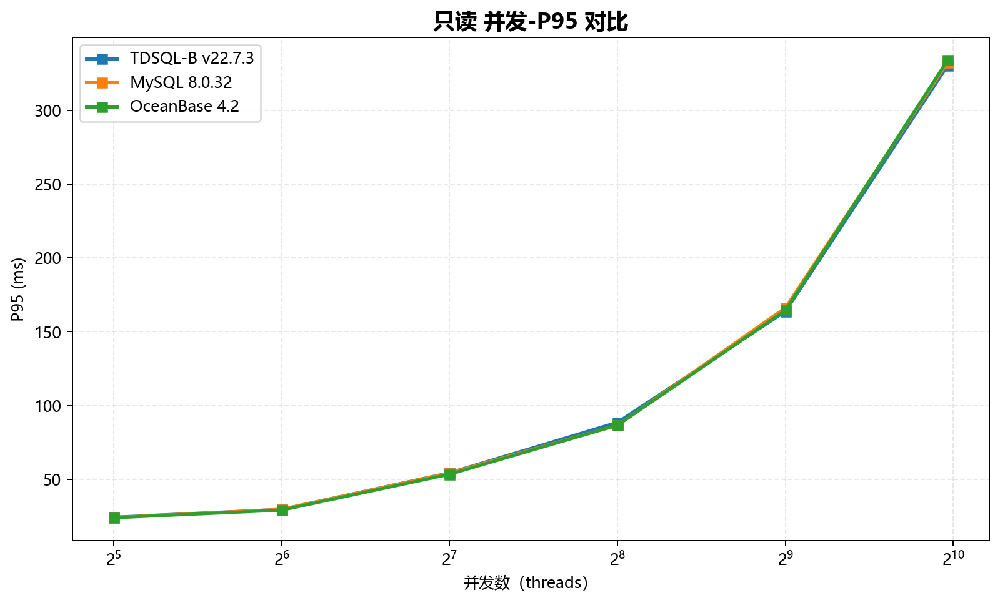
*只读并发-P95*

### 4.3 读写（oltp_read_write）

本场景独立比较；峰值取每产品六档并发中的最大 QPS。

| 产品 | 峰值并发 | 峰值QPS | 峰值P95 | 峰值P99 |
| --- | --- | --- | --- | --- |
| TDSQL-B v22.7.3 | 512 | 36,054 | 364.41 | 523.22 |
| MySQL 8.0.32 | 512 | 30,021 | 363.68 | 525.48 |
| OceanBase 4.2 | 512 | 33,315 | 359.37 | 501.07 |

| 并发 | TDSQL-B v22.7.3 QPS | MySQL 8.0.32 QPS | OceanBase 4.2 QPS | TDSQL-B v22.7.3 P95(ms) | MySQL 8.0.32 P95(ms) | OceanBase 4.2 P95(ms) |
| --- | --- | --- | --- | --- | --- | --- |
| 32 | 7,975 | 6,626 | 7,250 | 52.26 | 53.05 | 51.57 |
| 64 | 14,347 | 11,778 | 12,952 | 64.15 | 63.01 | 63.82 |
| 128 | 25,830 | 21,757 | 23,633 | 114.76 | 116.14 | 115.64 |
| 256 | 33,695 | 27,757 | 30,878 | 187.47 | 188.54 | 188.86 |
| 512 | 36,054 | 30,021 | 33,315 | 364.41 | 363.68 | 359.37 |
| 1000 | 33,812 | 28,485 | 31,218 | 732.19 | 731.16 | 731.99 |

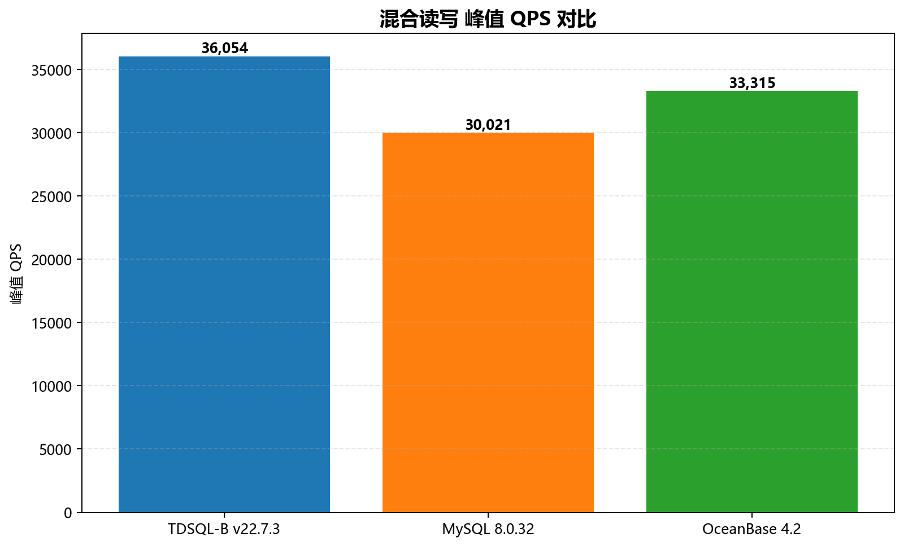
*读写峰值QPS*

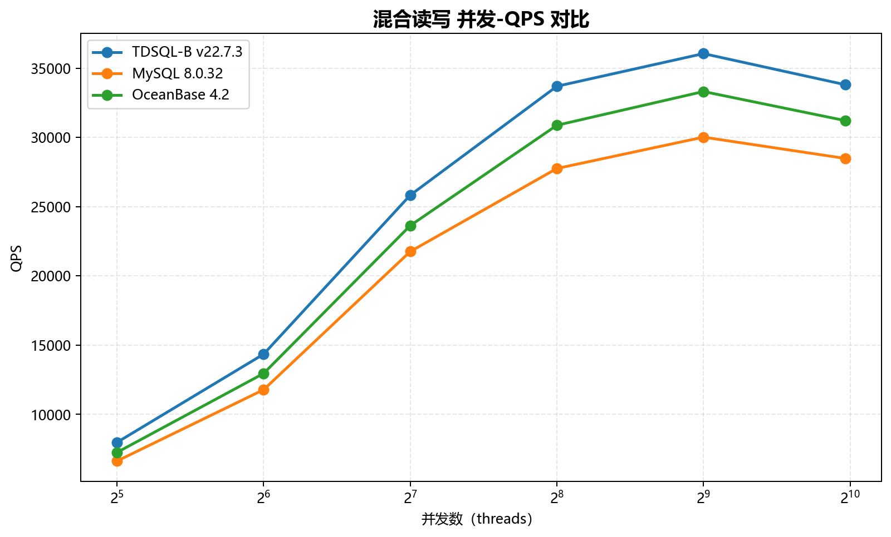
*读写并发-QPS*

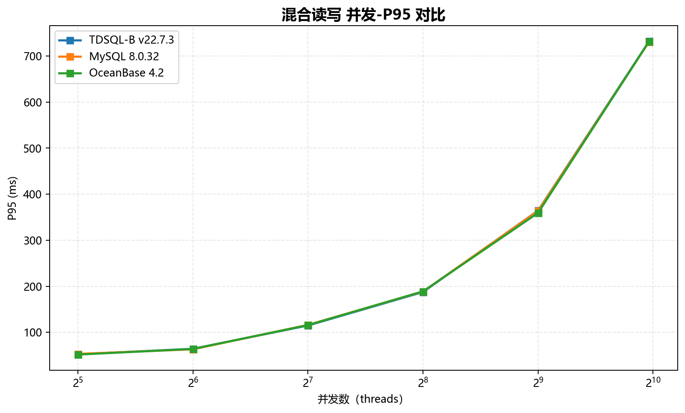
*读写并发-P95*

### 4.4 写入（oltp_write_only）

本场景独立比较；峰值取每产品六档并发中的最大 QPS。

| 产品 | 峰值并发 | 峰值QPS | 峰值P95 | 峰值P99 |
| --- | --- | --- | --- | --- |
| TDSQL-B v22.7.3 | 512 | 67,175 | 36.92 | 51.88 |
| MySQL 8.0.32 | 512 | 52,251 | 36.16 | 51.07 |
| OceanBase 4.2 | 512 | 60,428 | 36.55 | 51.93 |

| 并发 | TDSQL-B v22.7.3 QPS | MySQL 8.0.32 QPS | OceanBase 4.2 QPS | TDSQL-B v22.7.3 P95(ms) | MySQL 8.0.32 P95(ms) | OceanBase 4.2 P95(ms) |
| --- | --- | --- | --- | --- | --- | --- |
| 32 | 14,621 | 11,598 | 13,175 | 5.34 | 5.23 | 5.29 |
| 64 | 25,854 | 20,826 | 23,482 | 6.46 | 6.39 | 6.54 |
| 128 | 47,455 | 37,441 | 42,817 | 11.78 | 11.60 | 11.67 |
| 256 | 62,372 | 48,888 | 55,897 | 19.54 | 19.12 | 19.50 |
| 512 | 67,175 | 52,251 | 60,428 | 36.92 | 36.16 | 36.55 |
| 1000 | 62,141 | 49,414 | 56,431 | 73.08 | 73.64 | 72.95 |

*写入峰值QPS*

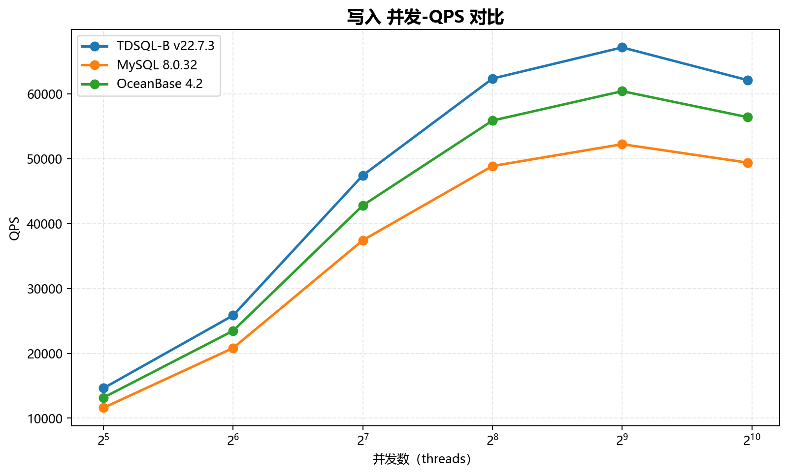
*写入并发-QPS*

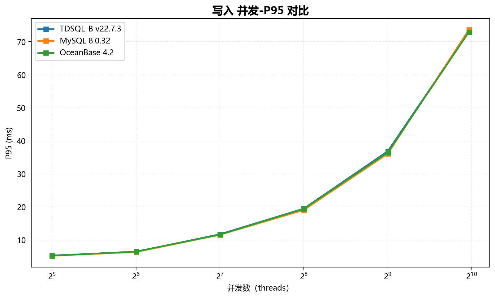
*写入并发-P95*

### 4.5 更新索引（oltp_update_index）

本场景独立比较；峰值取每产品六档并发中的最大 QPS。

| 产品 | 峰值并发 | 峰值QPS | 峰值P95 | 峰值P99 |
| --- | --- | --- | --- | --- |
| TDSQL-B v22.7.3 | 512 | 14,747 | 50.85 | 71.63 |
| MySQL 8.0.32 | 512 | 12,010 | 50.95 | 72.89 |
| OceanBase 4.2 | 512 | 13,058 | 51.43 | 70.27 |

| 并发 | TDSQL-B v22.7.3 QPS | MySQL 8.0.32 QPS | OceanBase 4.2 QPS | TDSQL-B v22.7.3 P95(ms) | MySQL 8.0.32 P95(ms) | OceanBase 4.2 P95(ms) |
| --- | --- | --- | --- | --- | --- | --- |
| 32 | 3,273 | 2,652 | 2,890 | 7.25 | 7.29 | 7.29 |
| 64 | 5,831 | 4,732 | 5,214 | 8.94 | 9.00 | 9.18 |
| 128 | 10,599 | 8,502 | 9,508 | 16.25 | 16.09 | 16.48 |
| 256 | 13,568 | 11,061 | 12,245 | 27.60 | 26.82 | 27.14 |
| 512 | 14,747 | 12,010 | 13,058 | 50.85 | 50.95 | 51.43 |
| 1000 | 13,966 | 11,356 | 12,326 | 100.99 | 103.42 | 100.69 |

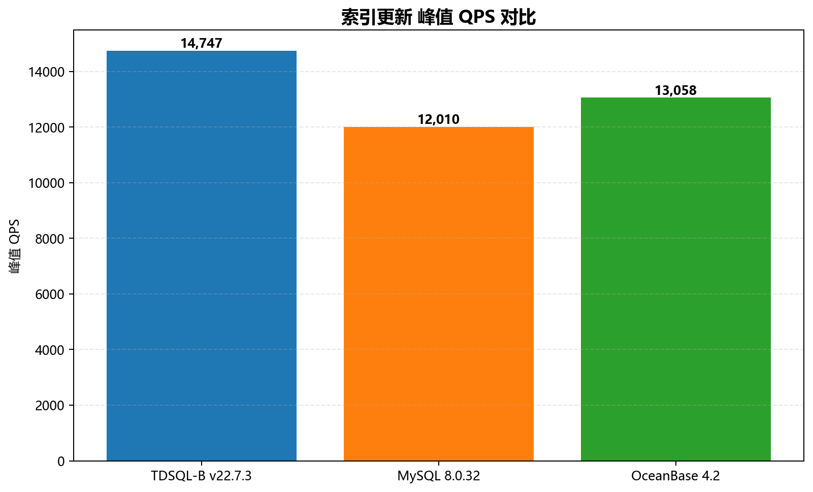
*更新索引峰值QPS*

*更新索引并发-QPS*

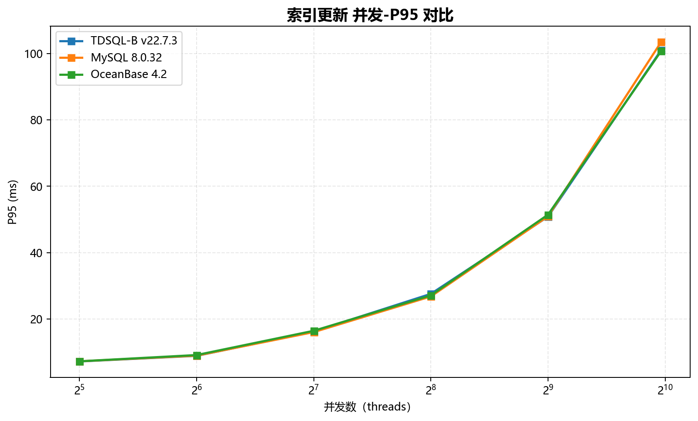
*更新索引并发-P95*

### 4.6 峰值QPS比值矩阵

以 TDSQL-B v22.7.3 为 1.00 基线，各产品取自身峰值。

| 场景 | TDSQL-B v22.7.3 | MySQL 8.0.32 | OceanBase 4.2 |
| --- | --- | --- | --- |
| 点查 | 1.000x | 0.797x | 0.886x |
| 只读 | 1.000x | 0.790x | 0.890x |
| 读写 | 1.000x | 0.833x | 0.924x |
| 写入 | 1.000x | 0.778x | 0.900x |
| 更新索引 | 1.000x | 0.814x | 0.885x |

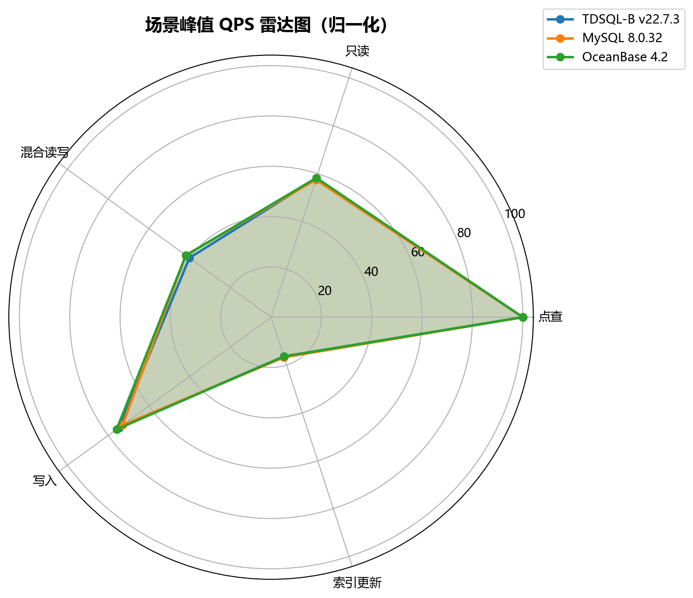
*峰值QPS场景雷达图*

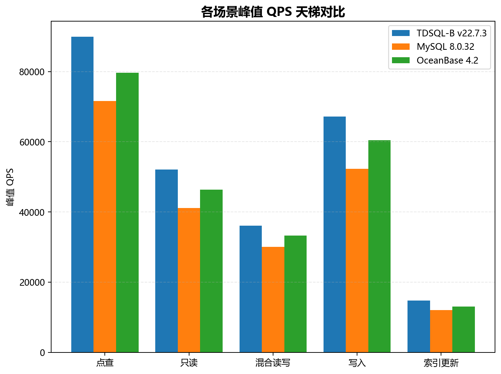
*各场景峰值QPS天梯图*

### 4.7 单产品并发曲线

各产品各场景的独立 QPS 曲线：

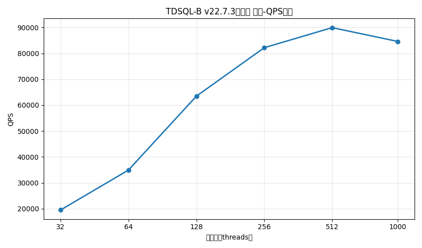
*TDSQL-B v22.7.3｜点查*

*TDSQL-B v22.7.3｜只读*

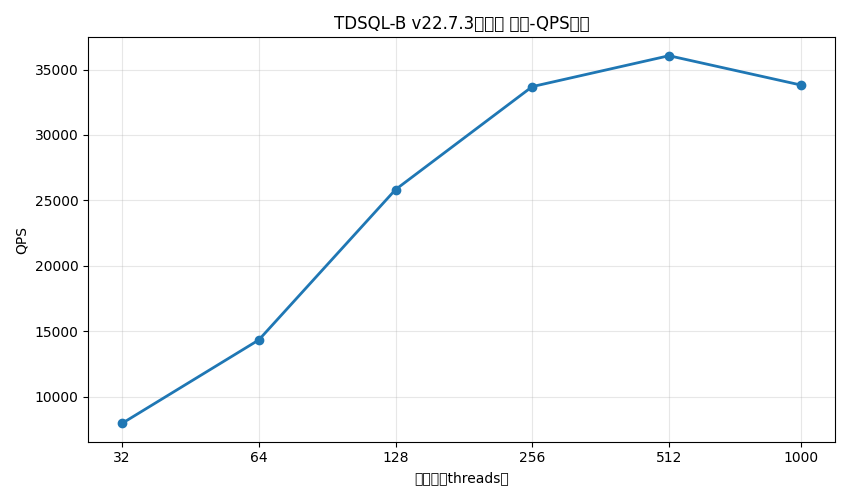
*TDSQL-B v22.7.3｜读写*

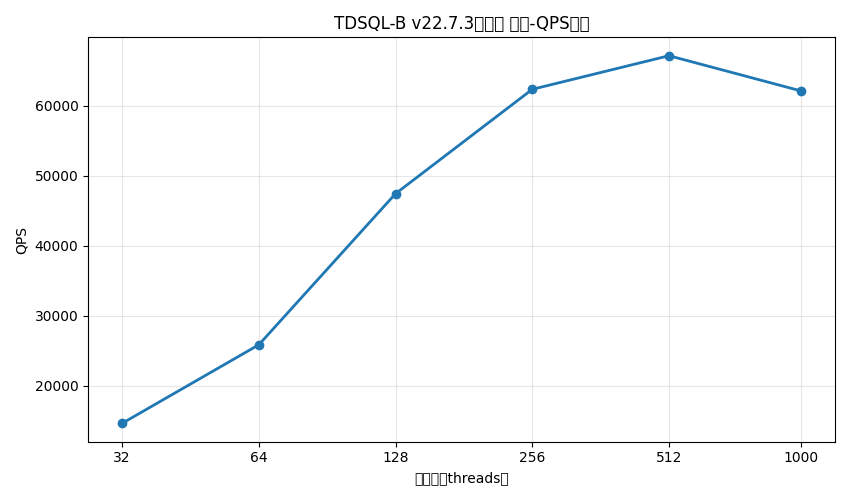
*TDSQL-B v22.7.3｜写入*

*TDSQL-B v22.7.3｜更新索引*

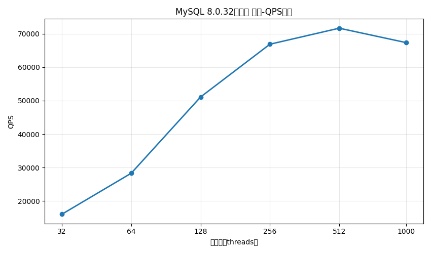
*MySQL 8.0.32｜点查*

*MySQL 8.0.32｜只读*

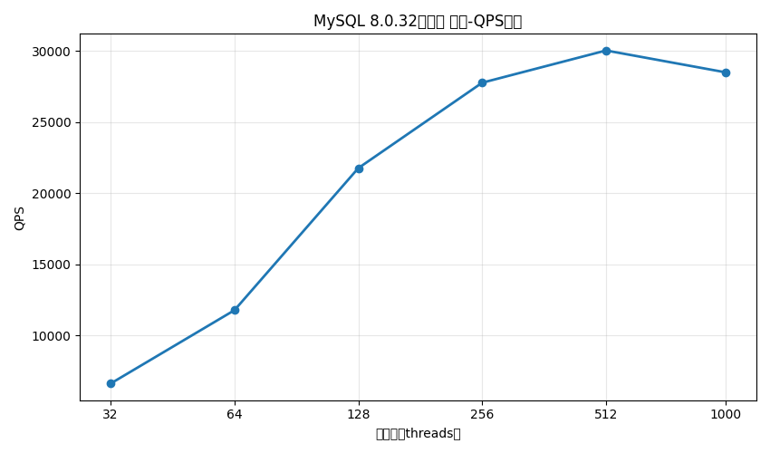
*MySQL 8.0.32｜读写*

*MySQL 8.0.32｜写入*

*MySQL 8.0.32｜更新索引*

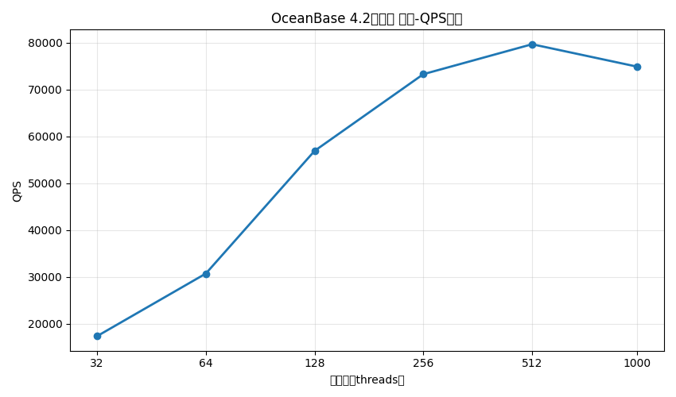
*OceanBase 4.2｜点查*

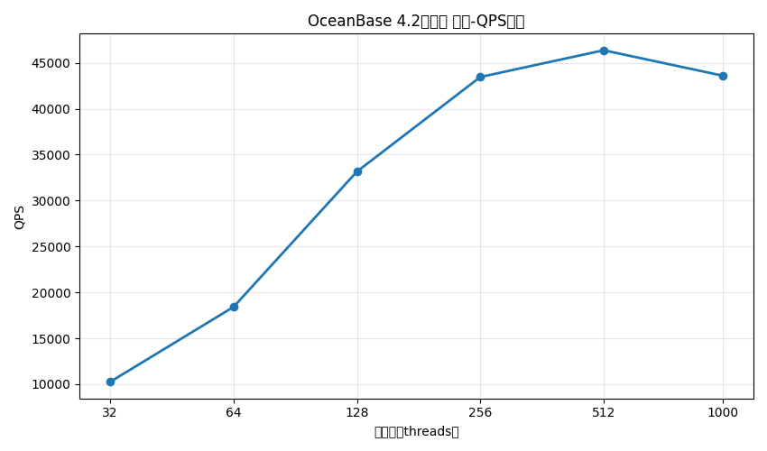
*OceanBase 4.2｜只读*

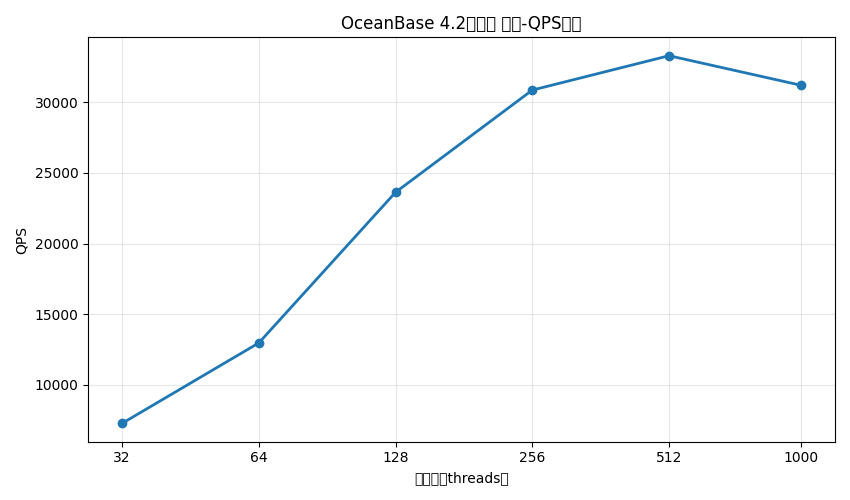
*OceanBase 4.2｜读写*

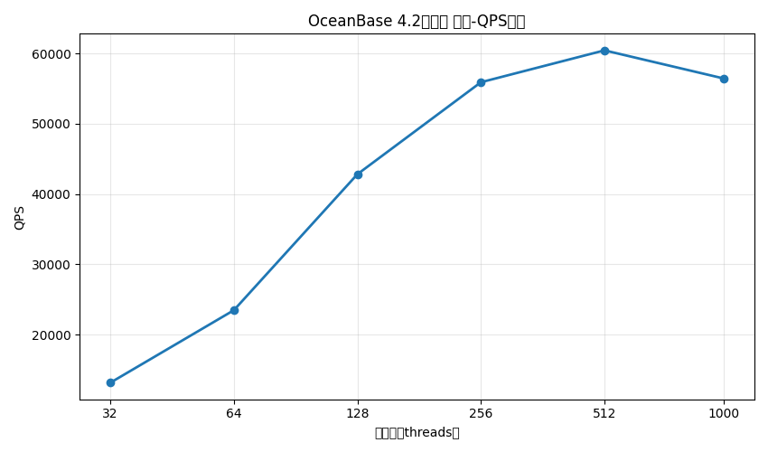
*OceanBase 4.2｜写入*

*OceanBase 4.2｜更新索引*

## 第 5 章 选型建议与边界

### 5.1 选型建议

- 按目标业务场景和并发查看各节，不将五个场景合并成单一总分。
- 形成生产选型前，建议同环境、同配置进行多轮交叉运行并报告中位数及波动范围。
- [待确认] 补充业务场景占比、延迟 SLA 和成本权重后再做加权决策；当前数据不足以指定综合胜者。

### 5.2 测试边界

结果仅描述本次 sysbench 汇总数据，受测试时间、批次及运行次数限制，不能直接外推到所有生产负载。

## 第 6 章 附录

### 6.1 数据来源

test-resource/mock_records_aggregation.json
