# 数据库性能对比报告

TDSQL-B v22.7.3 vs MySQL 8.0.32 vs OceanBase 4.2

日期：2026-06-19　版本：v1.0

## 目录

- [第 1 章 测试结论](#ch1)
- [第 2 章 测试环境](#ch2)
- [第 3 章 性能数据](#ch3)
- [第 4 章 横向对比分析](#ch4)
- [第 5 章 选型与调优建议](#ch5)
- [第 6 章 附录](#ch6)

# 第 1 章 测试结论

## 1.1 测试结论摘要

本报告为 comparison，覆盖三个产品、五个 sysbench 场景和六个并发档，共90条聚合记录。仅描述所提供数据，五场景独立比较，不计算跨场景均值或总排名。所有产品在每个场景的采样峰值均位于512并发，不能推定未采样负载下的真正极值。

【公平性限制 / STRONG】相同硬件等级未独立验证；数据库配置和重复测试证据不足。下列数值比较仅在输入标记条件成立的前提下有效，不能视为严格公平的基准认证。

## 1.2 关键性能数字

| 场景 | 产品 | 峰值并发 | TPS@QPS峰值 | 峰值QPS | P95 (ms) | P99 (ms) |
| --- | --- | --- | --- | --- | --- | --- |
| oltp_point_select | TDSQL-B v22.7.3 | 512 | 89,928.71 | 89,928.71 | 7.95 | 11.41 |
| oltp_point_select | MySQL 8.0.32 | 512 | 71,646.19 | 71,646.19 | 7.99 | 11.33 |
| oltp_point_select | OceanBase 4.2 | 512 | 79,641.75 | 79,641.75 | 7.84 | 11.24 |
| oltp_read_only | TDSQL-B v22.7.3 | 512 | 3,720.49 | 52,086.84 | 163.74 | 236.25 |
| oltp_read_only | MySQL 8.0.32 | 512 | 2,940.55 | 41,167.67 | 166.22 | 227.19 |
| oltp_read_only | OceanBase 4.2 | 512 | 3,312.35 | 46,372.94 | 164.39 | 236.92 |
| oltp_read_write | TDSQL-B v22.7.3 | 512 | 1,802.69 | 36,053.83 | 364.41 | 523.22 |
| oltp_read_write | MySQL 8.0.32 | 512 | 1,501.03 | 30,020.65 | 363.68 | 525.48 |
| oltp_read_write | OceanBase 4.2 | 512 | 1,665.76 | 33,315.16 | 359.37 | 501.07 |
| oltp_write_only | TDSQL-B v22.7.3 | 512 | 22,391.81 | 67,175.43 | 36.92 | 51.88 |
| oltp_write_only | MySQL 8.0.32 | 512 | 17,417.06 | 52,251.17 | 36.16 | 51.07 |
| oltp_write_only | OceanBase 4.2 | 512 | 20,142.74 | 60,428.22 | 36.55 | 51.93 |
| oltp_update_index | TDSQL-B v22.7.3 | 512 | 14,746.99 | 14,746.99 | 50.85 | 71.63 |
| oltp_update_index | MySQL 8.0.32 | 512 | 12,009.86 | 12,009.86 | 50.95 | 72.89 |
| oltp_update_index | OceanBase 4.2 | 512 | 13,057.94 | 13,057.94 | 51.43 | 70.27 |

## 1.3 核心结论

> ✅ L1 确定性结论 | 数据来源：data/compare.json records: scenario=oltp_point_select, threads=512; Python max/ratio
>
> oltp_point_select：TDSQL-B v22.7.3 采样峰值 QPS 89,928.71，高于 OceanBase 4.2（79,641.75）12.92%，高于 MySQL 8.0.32（71,646.19）25.52%；三者峰值均位于 512 并发。仅为本次数据的条件性比较。

> ✅ L1 确定性结论 | 数据来源：data/compare.json records: scenario=oltp_read_only, threads=512; Python max/ratio
>
> oltp_read_only：TDSQL-B v22.7.3 采样峰值 QPS 52,086.84，高于 OceanBase 4.2（46,372.94）12.32%，高于 MySQL 8.0.32（41,167.67）26.52%；三者峰值均位于 512 并发。仅为本次数据的条件性比较。

> ✅ L1 确定性结论 | 数据来源：data/compare.json records: scenario=oltp_read_write, threads=512; Python max/ratio
>
> oltp_read_write：TDSQL-B v22.7.3 采样峰值 QPS 36,053.83，高于 OceanBase 4.2（33,315.16）8.22%，高于 MySQL 8.0.32（30,020.65）20.10%；三者峰值均位于 512 并发。仅为本次数据的条件性比较。

> ✅ L1 确定性结论 | 数据来源：data/compare.json records: scenario=oltp_write_only, threads=512; Python max/ratio
>
> oltp_write_only：TDSQL-B v22.7.3 采样峰值 QPS 67,175.43，高于 OceanBase 4.2（60,428.22）11.17%，高于 MySQL 8.0.32（52,251.17）28.56%；三者峰值均位于 512 并发。仅为本次数据的条件性比较。

> ✅ L1 确定性结论 | 数据来源：data/compare.json records: scenario=oltp_update_index, threads=512; Python max/ratio
>
> oltp_update_index：TDSQL-B v22.7.3 采样峰值 QPS 14,746.99，高于 OceanBase 4.2（13,057.94）12.94%，高于 MySQL 8.0.32（12,009.86）22.79%；三者峰值均位于 512 并发。仅为本次数据的条件性比较。

# 第 2 章 测试环境

## 2.1 数据库测试配置

| 产品 | 工具 | 数据集 | 时长 (s) | 开始时间（输入原文） | 任务ID |
| --- | --- | --- | --- | --- | --- |
| TDSQL-B v22.7.3 | sysbench | tables=16, table_size=1000000 | 300 | 2026-06-11 09:30:00 | aa112233_tdsql_intel_x86 |
| MySQL 8.0.32 | sysbench | tables=16, table_size=1000000 | 300 | 2026-06-11 13:30:00 | bb445566_mysql_intel_x86 |
| OceanBase 4.2 | sysbench | tables=16, table_size=1000000 | 300 | 2026-06-11 17:30:00 | cc778899_ob_intel_x86 |

三产品的数据库参数、实例数量、拓扑、资源配额、持久化、复制和一致性设置均未提供。不可用产品名称推定部署方式。输入 start_time 未含时区，按原文展示。

## 2.2 硬件环境

| 项目 | 输入描述 |
| --- | --- |
| CPU | Intel(R) Xeon(R) Gold 6133 @ 2.50GHz, 64 cores |
| Memory | 256GB DDR4 |
| Disk | NVMe SSD 3.84TB |
| Network | 25Gbps |
| OS | TencentOS Server 3.1 |
| sysbench_version | 1.0.20 |

以上为输入的共用 test_env，不能证明各产品实际获得相同硬件资源。

## 2.3 测试方法

使用输入标记的 sysbench 1.0.20；tables=16、table_size=1000000，duration_sec=300。六档并发为32、64、128、256、512、1000。原始命令、运行顺序、预热与采样策略未提供。

| 标准场景 | 观测重点 |
| --- | --- |
| oltp_point_select | 点查：QPS、P95、P99 |
| oltp_read_only | 只读事务：TPS、QPS、P95、P99 |
| oltp_read_write | 混合读写：TPS、QPS、P95、P99 |
| oltp_write_only | 写入事务：TPS、QPS、P95、P99 |
| oltp_update_index | 索引更新：TPS、P95、P99 |

峰值按每产品、每场景六档QPS的最大值计算；同比=(A/B−1)×100%；扩展倍数=该档QPS/32并发QPS。比值基准为首个产品TDSQL-B。QPS越高、同场景同并发延迟越低越好，但吞吐与延迟需同时评估。

## 2.4 数据质量与公平性

90=3×5×6，组合唯一、逐产品逐场景六档齐全；TPS、QPS、P95、P99空值率均为0%。数据集与时长标记一致。每组合仅一条汇总记录，不能把六档并发当成重复样本。

[INFO] 相同场景、逐场景并发档、data_config 和 duration_sec 已核对一致；硬件描述已填充。

[STRONG] 公平性限制：仅提供共用硬件描述，缺少逐产品节点数、拓扑、资源配额及独占性证据；相同硬件等级未独立验证。下文仅对提供数据作条件性描述，不能据此作严格公平的产品优劣或因果结论。

[WEAK] 未提供数据库参数、隔离级别、持久化/刷盘、复制与一致性设置、连接方式、预热和缓存状态，事务与延迟统计口径未通过原始命令核实。

[WEAK] 各产品只有一个 task_id，缺少重复轮次、波动范围、原始日志和资源监控；不能计算显著性或置信区间，也不能确认瓶颈原因。

[WEAK] 三个产品 start_time 不同，可能存在时段或测试顺序影响；未提供随机化测试证据。

[INFO] 输入原 source_info 指向 test-resource/mock_records_aggregation.json；本次实际仅读取 data/compare.json，原标记不构成外部来源真实性或可达性验证。

# 第 3 章 性能数据

## 3.1 TDSQL-B v22.7.3 全量数据

| 场景 | 并发 | TPS | QPS | P95 (ms) | P99 (ms) |
| --- | --- | --- | --- | --- | --- |
| oltp_point_select | 32 | 19,494.95 | 19,494.95 | 1.14 | 1.64 |
| oltp_point_select | 64 | 34,925.66 | 34,925.66 | 1.39 | 2.00 |
| oltp_point_select | 128 | 63,461.25 | 63,461.25 | 2.52 | 3.58 |
| oltp_point_select | 256 | 82,178.62 | 82,178.62 | 4.25 | 6.10 |
| oltp_point_select | 512 | 89,928.71 | 89,928.71 | 7.95 | 11.41 |
| oltp_point_select | 1,000 | 84,599.90 | 84,599.90 | 15.62 | 21.71 |
| oltp_read_only | 32 | 828.61 | 11,600.60 | 24.28 | 32.80 |
| oltp_read_only | 64 | 1,458.11 | 20,413.59 | 29.61 | 42.40 |
| oltp_read_only | 128 | 2,676.63 | 37,472.87 | 54.35 | 76.63 |
| oltp_read_only | 256 | 3,515.52 | 49,217.26 | 88.54 | 123.43 |
| oltp_read_only | 512 | 3,720.49 | 52,086.84 | 163.74 | 236.25 |
| oltp_read_only | 1,000 | 3,510.42 | 49,145.88 | 330.30 | 460.76 |
| oltp_read_write | 32 | 398.73 | 7,974.60 | 52.26 | 74.48 |
| oltp_read_write | 64 | 717.34 | 14,346.84 | 64.15 | 92.98 |
| oltp_read_write | 128 | 1,291.52 | 25,830.30 | 114.76 | 155.59 |
| oltp_read_write | 256 | 1,684.73 | 33,694.61 | 187.47 | 260.10 |
| oltp_read_write | 512 | 1,802.69 | 36,053.83 | 364.41 | 523.22 |
| oltp_read_write | 1,000 | 1,690.58 | 33,811.66 | 732.19 | 999.62 |
| oltp_write_only | 32 | 4,873.50 | 14,620.51 | 5.34 | 7.70 |
| oltp_write_only | 64 | 8,617.85 | 25,853.55 | 6.46 | 9.31 |
| oltp_write_only | 128 | 15,818.31 | 47,454.94 | 11.78 | 16.72 |
| oltp_write_only | 256 | 20,790.68 | 62,372.04 | 19.54 | 28.18 |
| oltp_write_only | 512 | 22,391.81 | 67,175.43 | 36.92 | 51.88 |
| oltp_write_only | 1,000 | 20,713.72 | 62,141.15 | 73.08 | 102.59 |
| oltp_update_index | 32 | 3,273.38 | 3,273.38 | 7.25 | 10.05 |
| oltp_update_index | 64 | 5,830.92 | 5,830.92 | 8.94 | 12.70 |
| oltp_update_index | 128 | 10,598.84 | 10,598.84 | 16.25 | 22.76 |
| oltp_update_index | 256 | 13,567.85 | 13,567.85 | 27.60 | 37.76 |
| oltp_update_index | 512 | 14,746.99 | 14,746.99 | 50.85 | 71.63 |
| oltp_update_index | 1,000 | 13,965.57 | 13,965.57 | 100.99 | 137.41 |

## 3.2 MySQL 8.0.32 全量数据

| 场景 | 并发 | TPS | QPS | P95 (ms) | P99 (ms) |
| --- | --- | --- | --- | --- | --- |
| oltp_point_select | 32 | 16,074.87 | 16,074.87 | 1.16 | 1.64 |
| oltp_point_select | 64 | 28,323.44 | 28,323.44 | 1.39 | 1.92 |
| oltp_point_select | 128 | 51,088.25 | 51,088.25 | 2.54 | 3.59 |
| oltp_point_select | 256 | 66,856.78 | 66,856.78 | 4.26 | 5.85 |
| oltp_point_select | 512 | 71,646.19 | 71,646.19 | 7.99 | 11.33 |
| oltp_point_select | 1,000 | 67,337.58 | 67,337.58 | 15.89 | 22.27 |
| oltp_read_only | 32 | 651.85 | 9,125.96 | 24.03 | 32.93 |
| oltp_read_only | 64 | 1,177.93 | 16,491.00 | 29.61 | 40.50 |
| oltp_read_only | 128 | 2,099.20 | 29,388.81 | 54.17 | 73.19 |
| oltp_read_only | 256 | 2,761.20 | 38,656.85 | 86.59 | 122.84 |
| oltp_read_only | 512 | 2,940.55 | 41,167.67 | 166.22 | 227.19 |
| oltp_read_only | 1,000 | 2,804.41 | 39,261.75 | 332.48 | 463.32 |
| oltp_read_write | 32 | 331.28 | 6,625.69 | 53.05 | 72.02 |
| oltp_read_write | 64 | 588.92 | 11,778.34 | 63.01 | 85.92 |
| oltp_read_write | 128 | 1,087.87 | 21,757.36 | 116.14 | 164.18 |
| oltp_read_write | 256 | 1,387.86 | 27,757.19 | 188.54 | 262.82 |
| oltp_read_write | 512 | 1,501.03 | 30,020.65 | 363.68 | 525.48 |
| oltp_read_write | 1,000 | 1,424.25 | 28,484.97 | 731.16 | 1,057.62 |
| oltp_write_only | 32 | 3,865.91 | 11,597.72 | 5.23 | 7.52 |
| oltp_write_only | 64 | 6,942.02 | 20,826.05 | 6.39 | 8.98 |
| oltp_write_only | 128 | 12,480.43 | 37,441.30 | 11.60 | 16.12 |
| oltp_write_only | 256 | 16,295.91 | 48,887.74 | 19.12 | 26.79 |
| oltp_write_only | 512 | 17,417.06 | 52,251.17 | 36.16 | 51.07 |
| oltp_write_only | 1,000 | 16,471.39 | 49,414.16 | 73.64 | 100.31 |
| oltp_update_index | 32 | 2,652.17 | 2,652.17 | 7.29 | 10.11 |
| oltp_update_index | 64 | 4,731.63 | 4,731.63 | 9.00 | 12.90 |
| oltp_update_index | 128 | 8,501.76 | 8,501.76 | 16.09 | 21.76 |
| oltp_update_index | 256 | 11,060.74 | 11,060.74 | 26.82 | 37.02 |
| oltp_update_index | 512 | 12,009.86 | 12,009.86 | 50.95 | 72.89 |
| oltp_update_index | 1,000 | 11,356.38 | 11,356.38 | 103.42 | 148.48 |

## 3.3 OceanBase 4.2 全量数据

| 场景 | 并发 | TPS | QPS | P95 (ms) | P99 (ms) |
| --- | --- | --- | --- | --- | --- |
| oltp_point_select | 32 | 17,343.76 | 17,343.76 | 1.16 | 1.60 |
| oltp_point_select | 64 | 30,700.18 | 30,700.18 | 1.42 | 2.01 |
| oltp_point_select | 128 | 56,880.38 | 56,880.38 | 2.59 | 3.65 |
| oltp_point_select | 256 | 73,250.45 | 73,250.45 | 4.26 | 5.89 |
| oltp_point_select | 512 | 79,641.75 | 79,641.75 | 7.84 | 11.24 |
| oltp_point_select | 1,000 | 74,860.15 | 74,860.15 | 15.86 | 22.39 |
| oltp_read_only | 32 | 732.19 | 10,250.68 | 23.90 | 33.22 |
| oltp_read_only | 64 | 1,315.13 | 18,411.79 | 29.05 | 40.85 |
| oltp_read_only | 128 | 2,368.33 | 33,156.64 | 53.36 | 74.61 |
| oltp_read_only | 256 | 3,104.37 | 43,461.17 | 86.63 | 120.77 |
| oltp_read_only | 512 | 3,312.35 | 46,372.94 | 164.39 | 236.92 |
| oltp_read_only | 1,000 | 3,114.31 | 43,600.36 | 334.03 | 477.14 |
| oltp_read_write | 32 | 362.48 | 7,249.67 | 51.57 | 72.99 |
| oltp_read_write | 64 | 647.62 | 12,952.36 | 63.82 | 88.14 |
| oltp_read_write | 128 | 1,181.64 | 23,632.87 | 115.64 | 163.14 |
| oltp_read_write | 256 | 1,543.89 | 30,877.75 | 188.86 | 262.39 |
| oltp_read_write | 512 | 1,665.76 | 33,315.16 | 359.37 | 501.07 |
| oltp_read_write | 1,000 | 1,560.91 | 31,218.13 | 731.99 | 1,031.50 |
| oltp_write_only | 32 | 4,391.70 | 13,175.11 | 5.29 | 7.39 |
| oltp_write_only | 64 | 7,827.30 | 23,481.89 | 6.54 | 9.37 |
| oltp_write_only | 128 | 14,272.38 | 42,817.14 | 11.67 | 16.25 |
| oltp_write_only | 256 | 18,632.36 | 55,897.09 | 19.50 | 28.27 |
| oltp_write_only | 512 | 20,142.74 | 60,428.22 | 36.55 | 51.93 |
| oltp_write_only | 1,000 | 18,810.26 | 56,430.79 | 72.95 | 100.08 |
| oltp_update_index | 32 | 2,890.43 | 2,890.43 | 7.29 | 10.43 |
| oltp_update_index | 64 | 5,214.30 | 5,214.30 | 9.18 | 13.26 |
| oltp_update_index | 128 | 9,508.19 | 9,508.19 | 16.48 | 23.53 |
| oltp_update_index | 256 | 12,244.84 | 12,244.84 | 27.14 | 36.94 |
| oltp_update_index | 512 | 13,057.94 | 13,057.94 | 51.43 | 70.27 |
| oltp_update_index | 1,000 | 12,325.56 | 12,325.56 | 100.69 | 140.96 |

# 第 4 章 横向对比分析

## 4.1 单产品分析

### 4.1.1 TDSQL-B v22.7.3

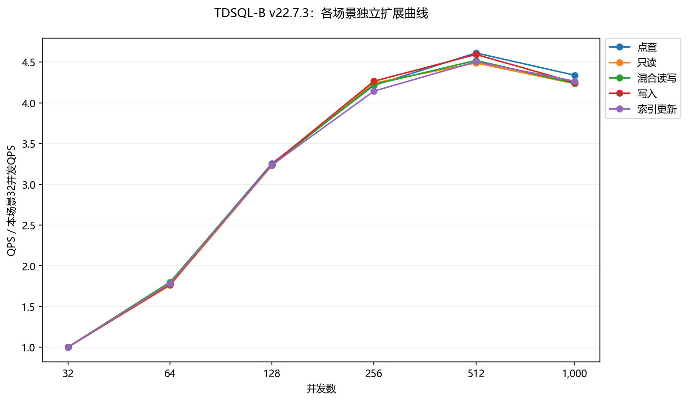
*图：TDSQL-B v22.7.3：各场景独立归一化扩展；每条曲线以本场景32并发QPS为1，不合并场景*

> ✅ L1 确定性结论 | 数据来源：data/compare.json records: product=TDSQL-B v22.7.3, scenario=oltp_point_select; Python max/ratio
>
> TDSQL-B v22.7.3 在 oltp_point_select 的采样峰值 QPS 为 89,928.71（512 并发），32→峰值扩展 4.61x；1,000 并发比峰值下降 5.93%，P95 从峰值处 7.95 升至 15.62 ms。

> ✅ L1 确定性结论 | 数据来源：data/compare.json records: product=TDSQL-B v22.7.3, scenario=oltp_read_only; Python max/ratio
>
> TDSQL-B v22.7.3 在 oltp_read_only 的采样峰值 QPS 为 52,086.84（512 并发），32→峰值扩展 4.49x；1,000 并发比峰值下降 5.65%，P95 从峰值处 163.74 升至 330.30 ms。

> ✅ L1 确定性结论 | 数据来源：data/compare.json records: product=TDSQL-B v22.7.3, scenario=oltp_read_write; Python max/ratio
>
> TDSQL-B v22.7.3 在 oltp_read_write 的采样峰值 QPS 为 36,053.83（512 并发），32→峰值扩展 4.52x；1,000 并发比峰值下降 6.22%，P95 从峰值处 364.41 升至 732.19 ms。

> ✅ L1 确定性结论 | 数据来源：data/compare.json records: product=TDSQL-B v22.7.3, scenario=oltp_write_only; Python max/ratio
>
> TDSQL-B v22.7.3 在 oltp_write_only 的采样峰值 QPS 为 67,175.43（512 并发），32→峰值扩展 4.59x；1,000 并发比峰值下降 7.49%，P95 从峰值处 36.92 升至 73.08 ms。

> ✅ L1 确定性结论 | 数据来源：data/compare.json records: product=TDSQL-B v22.7.3, scenario=oltp_update_index; Python max/ratio
>
> TDSQL-B v22.7.3 在 oltp_update_index 的采样峰值 QPS 为 14,746.99（512 并发），32→峰值扩展 4.51x；1,000 并发比峰值下降 5.30%，P95 从峰值处 50.85 升至 100.99 ms。

### 4.1.2 MySQL 8.0.32

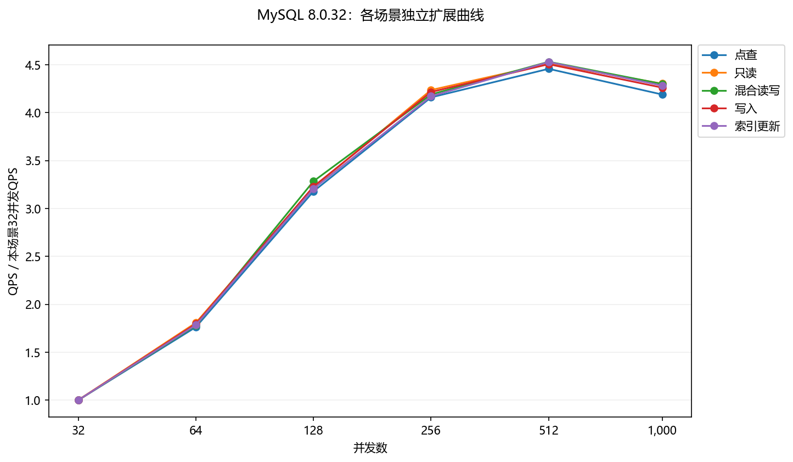
*图：MySQL 8.0.32：各场景独立归一化扩展；每条曲线以本场景32并发QPS为1，不合并场景*

> ✅ L1 确定性结论 | 数据来源：data/compare.json records: product=MySQL 8.0.32, scenario=oltp_point_select; Python max/ratio
>
> MySQL 8.0.32 在 oltp_point_select 的采样峰值 QPS 为 71,646.19（512 并发），32→峰值扩展 4.46x；1,000 并发比峰值下降 6.01%，P95 从峰值处 7.99 升至 15.89 ms。

> ✅ L1 确定性结论 | 数据来源：data/compare.json records: product=MySQL 8.0.32, scenario=oltp_read_only; Python max/ratio
>
> MySQL 8.0.32 在 oltp_read_only 的采样峰值 QPS 为 41,167.67（512 并发），32→峰值扩展 4.51x；1,000 并发比峰值下降 4.63%，P95 从峰值处 166.22 升至 332.48 ms。

> ✅ L1 确定性结论 | 数据来源：data/compare.json records: product=MySQL 8.0.32, scenario=oltp_read_write; Python max/ratio
>
> MySQL 8.0.32 在 oltp_read_write 的采样峰值 QPS 为 30,020.65（512 并发），32→峰值扩展 4.53x；1,000 并发比峰值下降 5.12%，P95 从峰值处 363.68 升至 731.16 ms。

> ✅ L1 确定性结论 | 数据来源：data/compare.json records: product=MySQL 8.0.32, scenario=oltp_write_only; Python max/ratio
>
> MySQL 8.0.32 在 oltp_write_only 的采样峰值 QPS 为 52,251.17（512 并发），32→峰值扩展 4.51x；1,000 并发比峰值下降 5.43%，P95 从峰值处 36.16 升至 73.64 ms。

> ✅ L1 确定性结论 | 数据来源：data/compare.json records: product=MySQL 8.0.32, scenario=oltp_update_index; Python max/ratio
>
> MySQL 8.0.32 在 oltp_update_index 的采样峰值 QPS 为 12,009.86（512 并发），32→峰值扩展 4.53x；1,000 并发比峰值下降 5.44%，P95 从峰值处 50.95 升至 103.42 ms。

### 4.1.3 OceanBase 4.2

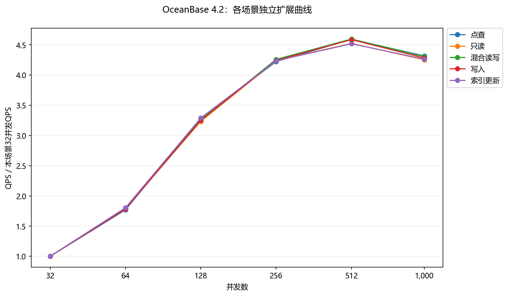
*图：OceanBase 4.2：各场景独立归一化扩展；每条曲线以本场景32并发QPS为1，不合并场景*

> ✅ L1 确定性结论 | 数据来源：data/compare.json records: product=OceanBase 4.2, scenario=oltp_point_select; Python max/ratio
>
> OceanBase 4.2 在 oltp_point_select 的采样峰值 QPS 为 79,641.75（512 并发），32→峰值扩展 4.59x；1,000 并发比峰值下降 6.00%，P95 从峰值处 7.84 升至 15.86 ms。

> ✅ L1 确定性结论 | 数据来源：data/compare.json records: product=OceanBase 4.2, scenario=oltp_read_only; Python max/ratio
>
> OceanBase 4.2 在 oltp_read_only 的采样峰值 QPS 为 46,372.94（512 并发），32→峰值扩展 4.52x；1,000 并发比峰值下降 5.98%，P95 从峰值处 164.39 升至 334.03 ms。

> ✅ L1 确定性结论 | 数据来源：data/compare.json records: product=OceanBase 4.2, scenario=oltp_read_write; Python max/ratio
>
> OceanBase 4.2 在 oltp_read_write 的采样峰值 QPS 为 33,315.16（512 并发），32→峰值扩展 4.60x；1,000 并发比峰值下降 6.29%，P95 从峰值处 359.37 升至 731.99 ms。

> ✅ L1 确定性结论 | 数据来源：data/compare.json records: product=OceanBase 4.2, scenario=oltp_write_only; Python max/ratio
>
> OceanBase 4.2 在 oltp_write_only 的采样峰值 QPS 为 60,428.22（512 并发），32→峰值扩展 4.59x；1,000 并发比峰值下降 6.62%，P95 从峰值处 36.55 升至 72.95 ms。

> ✅ L1 确定性结论 | 数据来源：data/compare.json records: product=OceanBase 4.2, scenario=oltp_update_index; Python max/ratio
>
> OceanBase 4.2 在 oltp_update_index 的采样峰值 QPS 为 13,057.94（512 并发），32→峰值扩展 4.52x；1,000 并发比峰值下降 5.61%，P95 从峰值处 51.43 升至 100.69 ms。

## 4.2 产品横向对比

### 4.2.1 点查（oltp_point_select）

> ✅ L1 确定性结论 | 数据来源：data/compare.json records: scenario=oltp_point_select, threads=512; Python max/ratio
>
> oltp_point_select：TDSQL-B v22.7.3 采样峰值 QPS 89,928.71，高于 OceanBase 4.2（79,641.75）12.92%，高于 MySQL 8.0.32（71,646.19）25.52%；三者峰值均位于 512 并发。仅为本次数据的条件性比较。

| 并发 | TDSQL-B v22.7.3 QPS | MySQL 8.0.32 QPS | OceanBase 4.2 QPS | TDSQL-B v22.7.3 P95(ms) | MySQL 8.0.32 P95(ms) | OceanBase 4.2 P95(ms) | TDSQL-B v22.7.3 P99(ms) | MySQL 8.0.32 P99(ms) | OceanBase 4.2 P99(ms) |
| --- | --- | --- | --- | --- | --- | --- | --- | --- | --- |
| 32 | 19,494.95 | 16,074.87 | 17,343.76 | 1.14 | 1.16 | 1.16 | 1.64 | 1.64 | 1.60 |
| 64 | 34,925.66 | 28,323.44 | 30,700.18 | 1.39 | 1.39 | 1.42 | 2.00 | 1.92 | 2.01 |
| 128 | 63,461.25 | 51,088.25 | 56,880.38 | 2.52 | 2.54 | 2.59 | 3.58 | 3.59 | 3.65 |
| 256 | 82,178.62 | 66,856.78 | 73,250.45 | 4.25 | 4.26 | 4.26 | 6.10 | 5.85 | 5.89 |
| 512 | 89,928.71 | 71,646.19 | 79,641.75 | 7.95 | 7.99 | 7.84 | 11.41 | 11.33 | 11.24 |
| 1,000 | 84,599.90 | 67,337.58 | 74,860.15 | 15.62 | 15.89 | 15.86 | 21.71 | 22.27 | 22.39 |

同为512并发时，最低P95为 OceanBase 4.2 的 7.84 ms，最低P99为 OceanBase 4.2 的 11.24 ms；吞吐领先不等于尾延迟同时领先。全六档数据见本节表格。

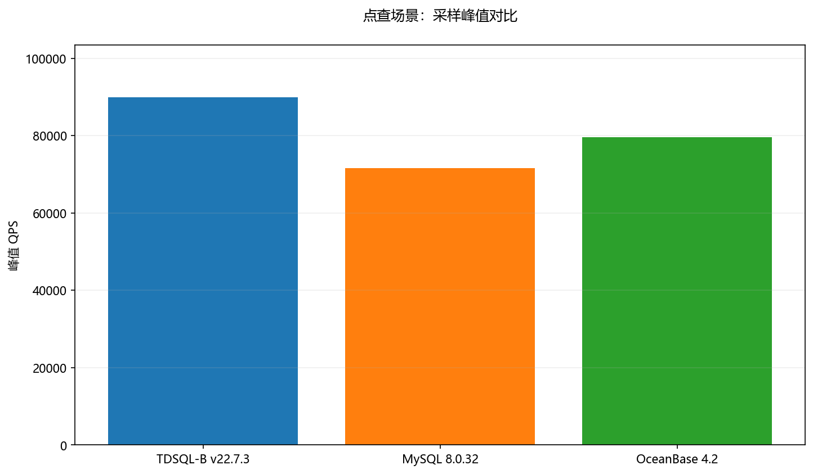
*图：点查：各产品采样峰值QPS，峰值均为512并发*

*图：点查：三产品六档并发QPS，线段仅连接采样点*

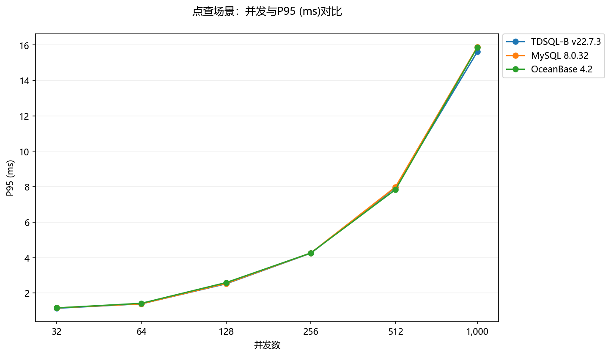
*图：点查：三产品六档并发P95延迟（ms）*

### 4.2.2 只读（oltp_read_only）

> ✅ L1 确定性结论 | 数据来源：data/compare.json records: scenario=oltp_read_only, threads=512; Python max/ratio
>
> oltp_read_only：TDSQL-B v22.7.3 采样峰值 QPS 52,086.84，高于 OceanBase 4.2（46,372.94）12.32%，高于 MySQL 8.0.32（41,167.67）26.52%；三者峰值均位于 512 并发。仅为本次数据的条件性比较。

| 并发 | TDSQL-B v22.7.3 QPS | MySQL 8.0.32 QPS | OceanBase 4.2 QPS | TDSQL-B v22.7.3 P95(ms) | MySQL 8.0.32 P95(ms) | OceanBase 4.2 P95(ms) | TDSQL-B v22.7.3 P99(ms) | MySQL 8.0.32 P99(ms) | OceanBase 4.2 P99(ms) |
| --- | --- | --- | --- | --- | --- | --- | --- | --- | --- |
| 32 | 11,600.60 | 9,125.96 | 10,250.68 | 24.28 | 24.03 | 23.90 | 32.80 | 32.93 | 33.22 |
| 64 | 20,413.59 | 16,491.00 | 18,411.79 | 29.61 | 29.61 | 29.05 | 42.40 | 40.50 | 40.85 |
| 128 | 37,472.87 | 29,388.81 | 33,156.64 | 54.35 | 54.17 | 53.36 | 76.63 | 73.19 | 74.61 |
| 256 | 49,217.26 | 38,656.85 | 43,461.17 | 88.54 | 86.59 | 86.63 | 123.43 | 122.84 | 120.77 |
| 512 | 52,086.84 | 41,167.67 | 46,372.94 | 163.74 | 166.22 | 164.39 | 236.25 | 227.19 | 236.92 |
| 1,000 | 49,145.88 | 39,261.75 | 43,600.36 | 330.30 | 332.48 | 334.03 | 460.76 | 463.32 | 477.14 |

同为512并发时，最低P95为 TDSQL-B v22.7.3 的 163.74 ms，最低P99为 MySQL 8.0.32 的 227.19 ms；吞吐领先不等于尾延迟同时领先。全六档数据见本节表格。

*图：只读：各产品采样峰值QPS，峰值均为512并发*

*图：只读：三产品六档并发QPS，线段仅连接采样点*

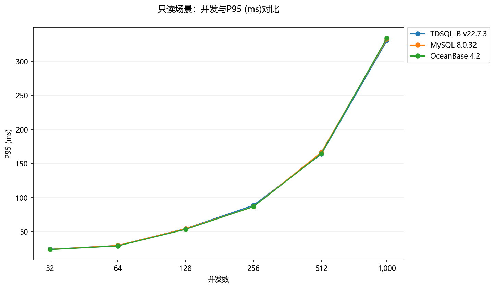
*图：只读：三产品六档并发P95延迟（ms）*

### 4.2.3 混合读写（oltp_read_write）

> ✅ L1 确定性结论 | 数据来源：data/compare.json records: scenario=oltp_read_write, threads=512; Python max/ratio
>
> oltp_read_write：TDSQL-B v22.7.3 采样峰值 QPS 36,053.83，高于 OceanBase 4.2（33,315.16）8.22%，高于 MySQL 8.0.32（30,020.65）20.10%；三者峰值均位于 512 并发。仅为本次数据的条件性比较。

| 并发 | TDSQL-B v22.7.3 QPS | MySQL 8.0.32 QPS | OceanBase 4.2 QPS | TDSQL-B v22.7.3 P95(ms) | MySQL 8.0.32 P95(ms) | OceanBase 4.2 P95(ms) | TDSQL-B v22.7.3 P99(ms) | MySQL 8.0.32 P99(ms) | OceanBase 4.2 P99(ms) |
| --- | --- | --- | --- | --- | --- | --- | --- | --- | --- |
| 32 | 7,974.60 | 6,625.69 | 7,249.67 | 52.26 | 53.05 | 51.57 | 74.48 | 72.02 | 72.99 |
| 64 | 14,346.84 | 11,778.34 | 12,952.36 | 64.15 | 63.01 | 63.82 | 92.98 | 85.92 | 88.14 |
| 128 | 25,830.30 | 21,757.36 | 23,632.87 | 114.76 | 116.14 | 115.64 | 155.59 | 164.18 | 163.14 |
| 256 | 33,694.61 | 27,757.19 | 30,877.75 | 187.47 | 188.54 | 188.86 | 260.10 | 262.82 | 262.39 |
| 512 | 36,053.83 | 30,020.65 | 33,315.16 | 364.41 | 363.68 | 359.37 | 523.22 | 525.48 | 501.07 |
| 1,000 | 33,811.66 | 28,484.97 | 31,218.13 | 732.19 | 731.16 | 731.99 | 999.62 | 1,057.62 | 1,031.50 |

同为512并发时，最低P95为 OceanBase 4.2 的 359.37 ms，最低P99为 OceanBase 4.2 的 501.07 ms；吞吐领先不等于尾延迟同时领先。全六档数据见本节表格。

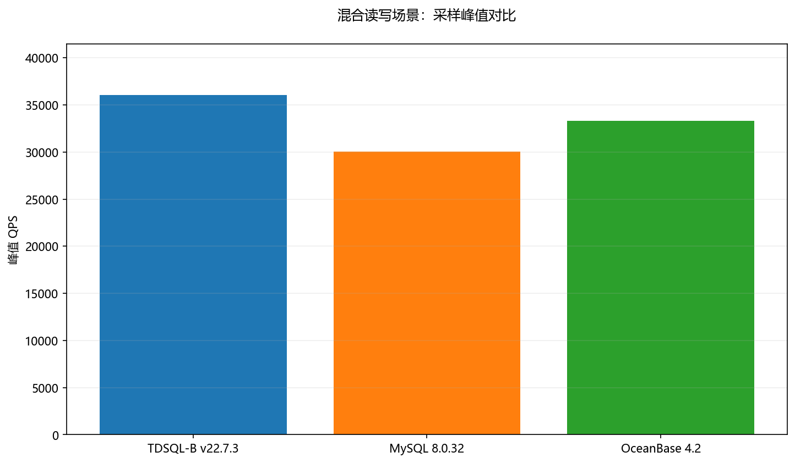
*图：混合读写：各产品采样峰值QPS，峰值均为512并发*

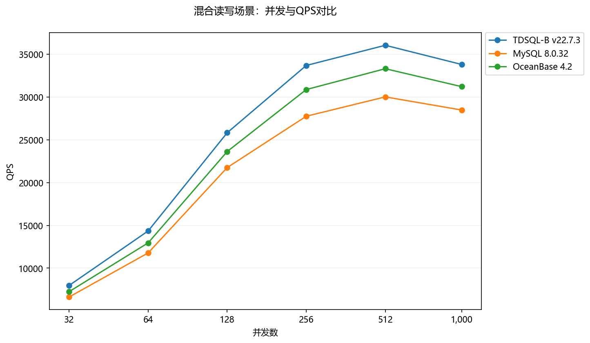
*图：混合读写：三产品六档并发QPS，线段仅连接采样点*

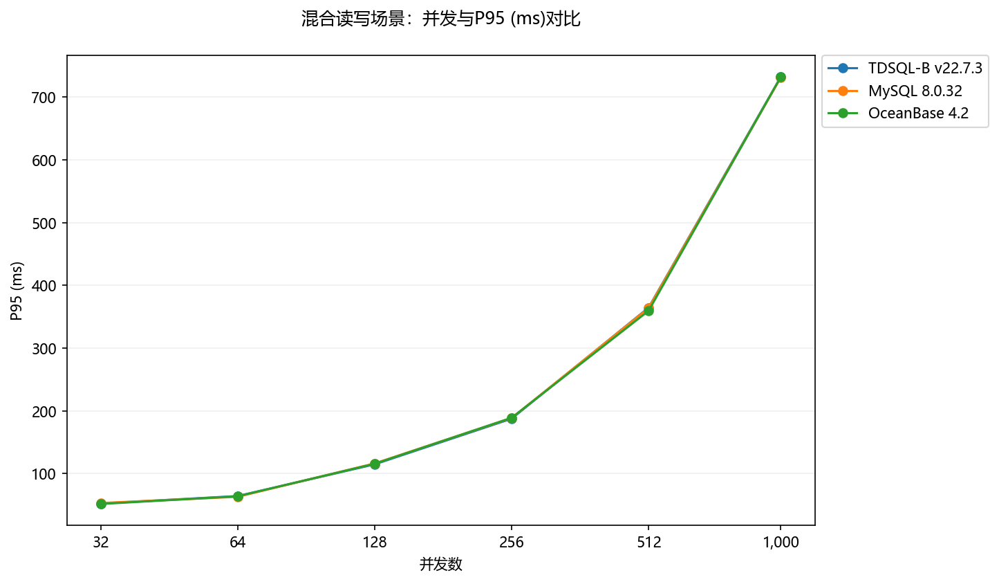
*图：混合读写：三产品六档并发P95延迟（ms）*

### 4.2.4 写入（oltp_write_only）

> ✅ L1 确定性结论 | 数据来源：data/compare.json records: scenario=oltp_write_only, threads=512; Python max/ratio
>
> oltp_write_only：TDSQL-B v22.7.3 采样峰值 QPS 67,175.43，高于 OceanBase 4.2（60,428.22）11.17%，高于 MySQL 8.0.32（52,251.17）28.56%；三者峰值均位于 512 并发。仅为本次数据的条件性比较。

| 并发 | TDSQL-B v22.7.3 QPS | MySQL 8.0.32 QPS | OceanBase 4.2 QPS | TDSQL-B v22.7.3 P95(ms) | MySQL 8.0.32 P95(ms) | OceanBase 4.2 P95(ms) | TDSQL-B v22.7.3 P99(ms) | MySQL 8.0.32 P99(ms) | OceanBase 4.2 P99(ms) |
| --- | --- | --- | --- | --- | --- | --- | --- | --- | --- |
| 32 | 14,620.51 | 11,597.72 | 13,175.11 | 5.34 | 5.23 | 5.29 | 7.70 | 7.52 | 7.39 |
| 64 | 25,853.55 | 20,826.05 | 23,481.89 | 6.46 | 6.39 | 6.54 | 9.31 | 8.98 | 9.37 |
| 128 | 47,454.94 | 37,441.30 | 42,817.14 | 11.78 | 11.60 | 11.67 | 16.72 | 16.12 | 16.25 |
| 256 | 62,372.04 | 48,887.74 | 55,897.09 | 19.54 | 19.12 | 19.50 | 28.18 | 26.79 | 28.27 |
| 512 | 67,175.43 | 52,251.17 | 60,428.22 | 36.92 | 36.16 | 36.55 | 51.88 | 51.07 | 51.93 |
| 1,000 | 62,141.15 | 49,414.16 | 56,430.79 | 73.08 | 73.64 | 72.95 | 102.59 | 100.31 | 100.08 |

同为512并发时，最低P95为 MySQL 8.0.32 的 36.16 ms，最低P99为 MySQL 8.0.32 的 51.07 ms；吞吐领先不等于尾延迟同时领先。全六档数据见本节表格。

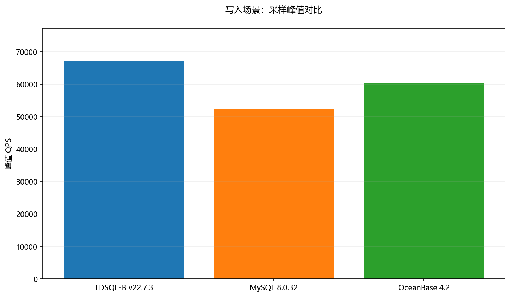
*图：写入：各产品采样峰值QPS，峰值均为512并发*

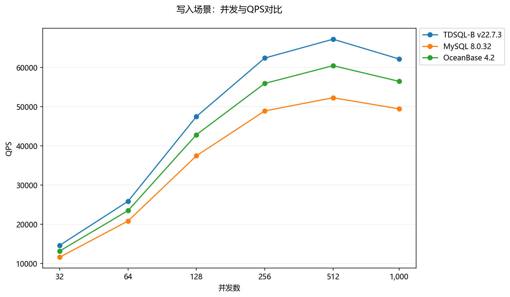
*图：写入：三产品六档并发QPS，线段仅连接采样点*

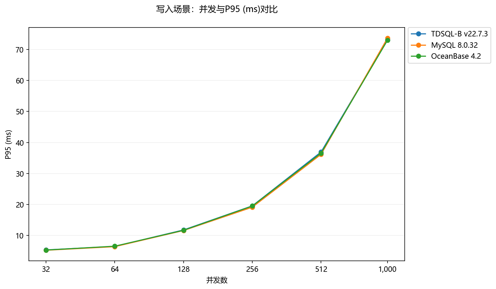
*图：写入：三产品六档并发P95延迟（ms）*

### 4.2.5 索引更新（oltp_update_index）

> ✅ L1 确定性结论 | 数据来源：data/compare.json records: scenario=oltp_update_index, threads=512; Python max/ratio
>
> oltp_update_index：TDSQL-B v22.7.3 采样峰值 QPS 14,746.99，高于 OceanBase 4.2（13,057.94）12.94%，高于 MySQL 8.0.32（12,009.86）22.79%；三者峰值均位于 512 并发。仅为本次数据的条件性比较。

| 并发 | TDSQL-B v22.7.3 QPS | MySQL 8.0.32 QPS | OceanBase 4.2 QPS | TDSQL-B v22.7.3 P95(ms) | MySQL 8.0.32 P95(ms) | OceanBase 4.2 P95(ms) | TDSQL-B v22.7.3 P99(ms) | MySQL 8.0.32 P99(ms) | OceanBase 4.2 P99(ms) |
| --- | --- | --- | --- | --- | --- | --- | --- | --- | --- |
| 32 | 3,273.38 | 2,652.17 | 2,890.43 | 7.25 | 7.29 | 7.29 | 10.05 | 10.11 | 10.43 |
| 64 | 5,830.92 | 4,731.63 | 5,214.30 | 8.94 | 9.00 | 9.18 | 12.70 | 12.90 | 13.26 |
| 128 | 10,598.84 | 8,501.76 | 9,508.19 | 16.25 | 16.09 | 16.48 | 22.76 | 21.76 | 23.53 |
| 256 | 13,567.85 | 11,060.74 | 12,244.84 | 27.60 | 26.82 | 27.14 | 37.76 | 37.02 | 36.94 |
| 512 | 14,746.99 | 12,009.86 | 13,057.94 | 50.85 | 50.95 | 51.43 | 71.63 | 72.89 | 70.27 |
| 1,000 | 13,965.57 | 11,356.38 | 12,325.56 | 100.99 | 103.42 | 100.69 | 137.41 | 148.48 | 140.96 |

同为512并发时，最低P95为 TDSQL-B v22.7.3 的 50.85 ms，最低P99为 OceanBase 4.2 的 70.27 ms；吞吐领先不等于尾延迟同时领先。全六档数据见本节表格。

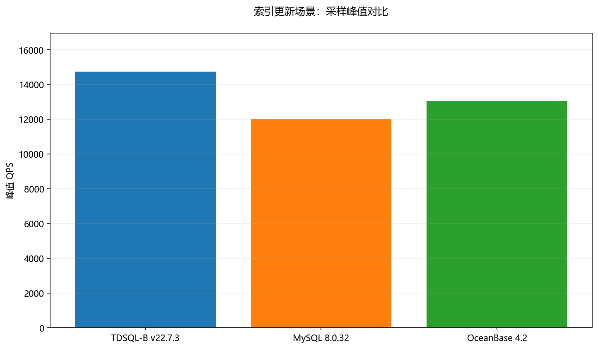
*图：索引更新：各产品采样峰值QPS，峰值均为512并发*

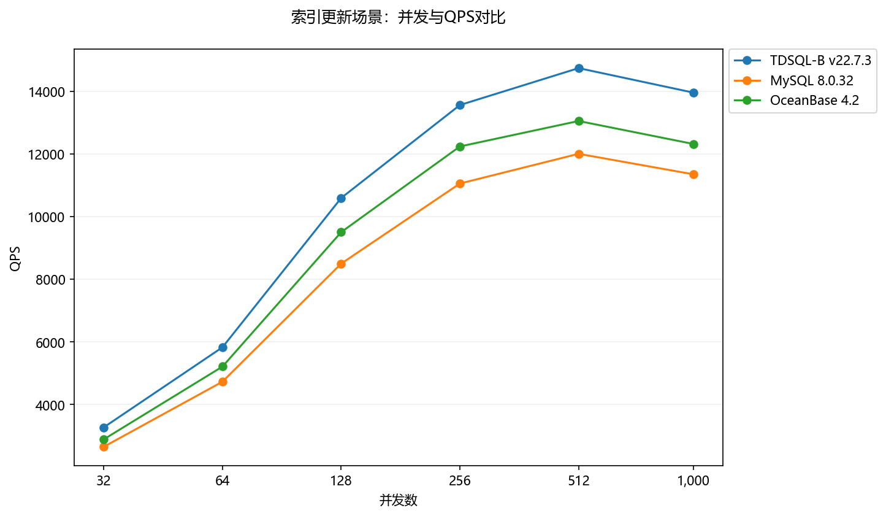
*图：索引更新：三产品六档并发QPS，线段仅连接采样点*

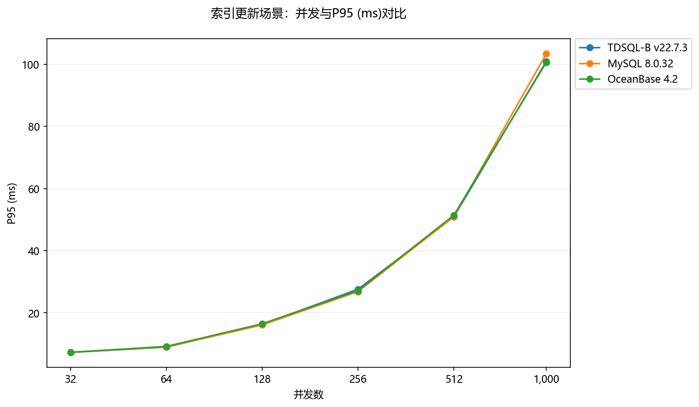
*图：索引更新：三产品六档并发P95延迟（ms）*

### 4.2.6 性能比值矩阵与场景内分值

比值=本产品该场景峰值QPS/TDSQL-B该场景峰值QPS，基准为1.0000x。场景内分值=本产品峰值QPS/该场景三产品最大峰值QPS×100。不代表成本、稳定性、延迟综合效用；无业务权重，不计算跨场景总分、合并均值或总排名。

| 场景 | TDSQL-B v22.7.3 | MySQL 8.0.32 | OceanBase 4.2 |
| --- | --- | --- | --- |
| oltp_point_select | 1.0000x | 0.7967x | 0.8856x |
| oltp_read_only | 1.0000x | 0.7904x | 0.8903x |
| oltp_read_write | 1.0000x | 0.8327x | 0.9240x |
| oltp_write_only | 1.0000x | 0.7778x | 0.8996x |
| oltp_update_index | 1.0000x | 0.8144x | 0.8855x |

| 场景 | TDSQL-B v22.7.3 | MySQL 8.0.32 | OceanBase 4.2 |
| --- | --- | --- | --- |
| oltp_point_select | 100.00 | 79.67 | 88.56 |
| oltp_read_only | 100.00 | 79.04 | 89.03 |
| oltp_read_write | 100.00 | 83.27 | 92.40 |
| oltp_write_only | 100.00 | 77.78 | 89.96 |
| oltp_update_index | 100.00 | 81.44 | 88.55 |

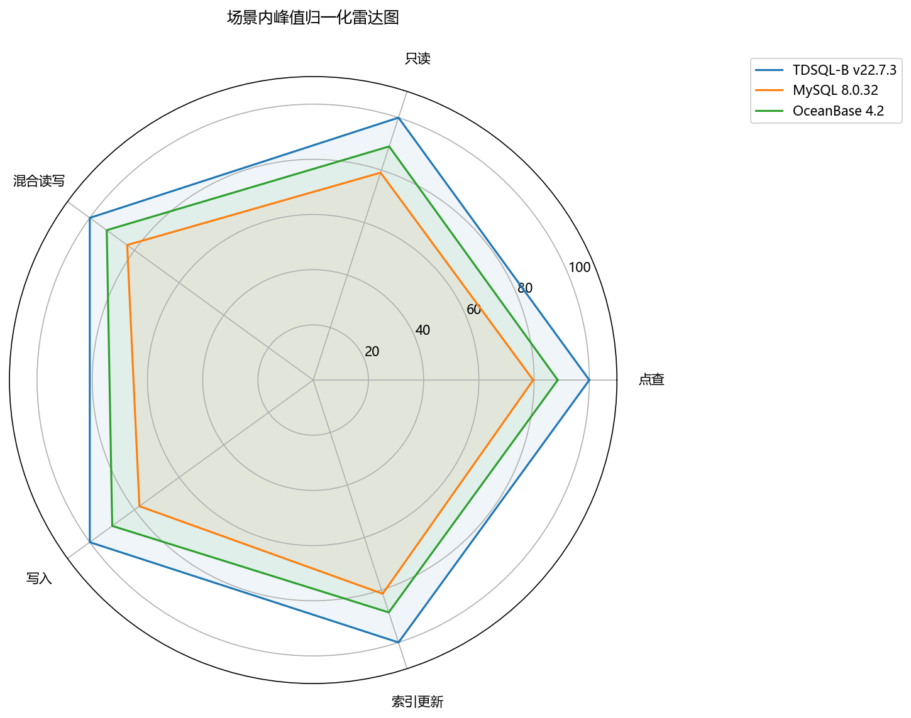
*图：雷达图：每个轴单独按本场景最大峰值QPS归一化至100*

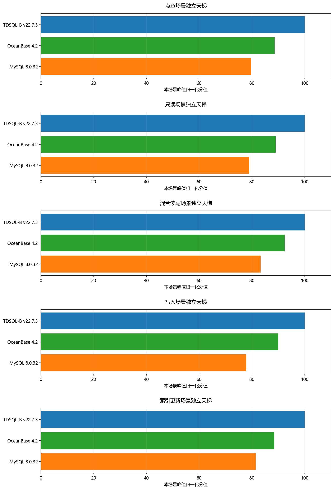
*图：天梯图：五个独立场景各自展示归一化分值与顺序，无跨场景总排名*

# 第 5 章 选型与调优建议

## 5.1 选型决策树

- 先核实逐产品硬件、拓扑与配置；若无法对齐，保留条件性比较，不做最终产品优劣判断。
- 条件对齐后，确定业务对应场景及延迟SLO；按同场景同并发的QPS、P95、P99筛选。
- 若吞吐优先，可把本次场景峰值作为复测候选；若延迟优先，按第4章各档延迟选择并发，再用业务负载复测。
- 若尚无延迟SLO或成本数据，暂不作最终容量与性价比结论。

## 5.2 适用场景矩阵

| 场景 | 本次吞吐候选（条件性） | 后续验证 |
| --- | --- | --- |
| oltp_point_select | TDSQL-B v22.7.3 | 核实配置，重复测试；校验业务P95/P99门限 |
| oltp_read_only | TDSQL-B v22.7.3 | 核实配置，重复测试；校验业务P95/P99门限 |
| oltp_read_write | TDSQL-B v22.7.3 | 核实配置，重复测试；校验业务P95/P99门限 |
| oltp_write_only | TDSQL-B v22.7.3 | 核实配置，重复测试；校验业务P95/P99门限 |
| oltp_update_index | TDSQL-B v22.7.3 | 核实配置，重复测试；校验业务P95/P99门限 |

## 5.3 与对标产品的差异

本次数据的场景内吞吐顺序见第1章和第4章；P95与P99并非始终按该顺序排序。输入未提供功能、成本、运维复杂度或可用性数据，不据此作相关优劣结论。

## 5.4 调优最佳实践

本次所有场景采样峰值均在512并发；增加至1000并发后QPS下降、P95上升，建议在256、512、1000并发间补充更密采样，结合业务SLO确定并发上限。512仅为当前采样峰值，不是生产推荐值。先固定持久化与一致性设置、记录预热和资源监控，再逐项变更参数并重复采样；现有数据不足以给出buffer_pool、NUMA等具体参数值或瓶颈归因。

## 5.5 测试边界

仅涵盖本文件列出的产品版本、五类OLTP场景、标记数据集、300秒测试和六个并发档；没有故障恢复、长时稳定性、OLAP、真实业务或成本证据。公平性STRONG限制在完成硬件与拓扑核实前持续有效。

# 第 6 章 附录

## 6.1 原始数据来源

实际读取：data/compare.json；原source_info仅作输入元数据保留，未读取或验证其中指向的其他文件。原始记录未经修改，规范化产物只更新来源说明并追加质量信息。

| 文件 | 用途 |
| --- | --- |
| data/intent.json | 识别结果与固定时间 |
| data/extracted_data.json | 90条完整记录与来源说明 |
| data/analysis_results.json | 计算结果、公平性限制与公式 |
| data/insights.json | 逐场景L1洞察及来源 |
| data/quality.json | 数据质量与覆盖检查 |
| data/chart_qa.json | 20图文字重叠检查 |
| data/input_hashes.json | 输入与Skill文件SHA256 |
| docs/checks.md | 交付核查结果 |

## 6.2 sysbench命令与计算边界

原始sysbench命令未提供，无法复原连接参数、Lua脚本选项与实际统计过程；本报告不伪造可复现命令。基于聚合结果进行描述性计算，不对缺失样本估算数据。

报告日期按指定固定时间2026-06-19T16:00:00+08:00生成；测试时间使用输入原文。报告不依赖外部服务、不安装依赖。
