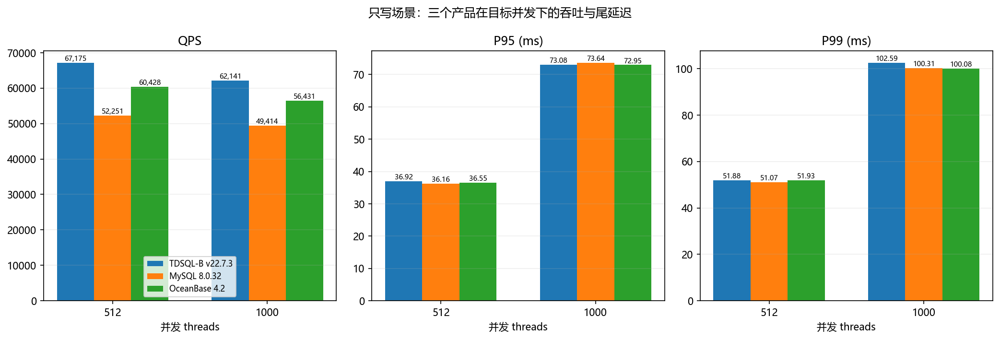
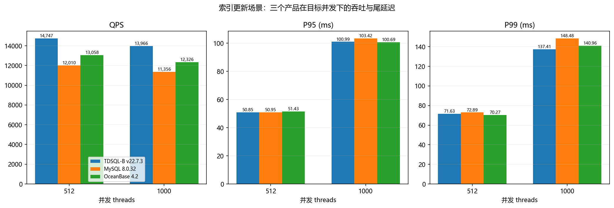
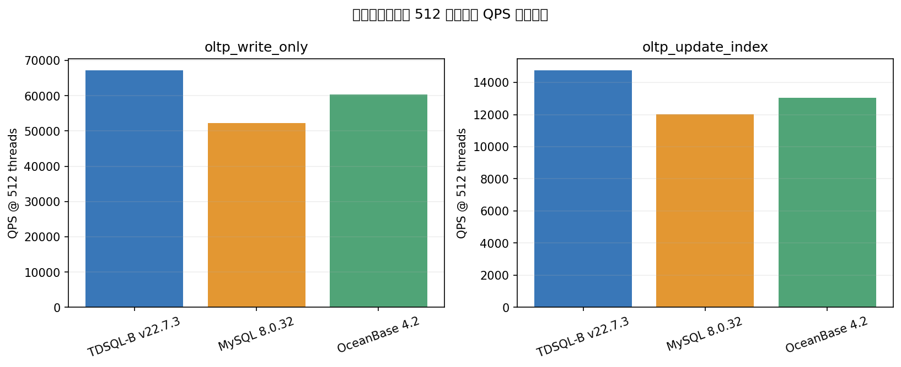

# 数据库专项性能报告

> oltp_write_only 与 oltp_update_index｜512、1000 并发｜3 产品

- **日期**：2026-06-19
- **版本**：v1.0

---

## 目录

- [第 1 章 分析目标](#第-1-章-分析目标)
  - [1.1 用户需求](#11-用户需求)
  - [1.2 关键发现摘要](#12-关键发现摘要)
  - [1.3 oltp_write_only 数据摘要](#13-oltpwriteonly-数据摘要)
  - [1.4 oltp_update_index 数据摘要](#14-oltpupdateindex-数据摘要)
- [第 2 章 测试环境与数据范围](#第-2-章-测试环境与数据范围)
  - [2.1 数据来源与子集](#21-数据来源与子集)
  - [2.2 环境和比较前提](#22-环境和比较前提)
  - [2.3 指标口径与假设](#23-指标口径与假设)
- [第 3 章 oltp_write_only 专项分析](#第-3-章-oltpwriteonly-专项分析)
  - [3.1 逐产品数据（只写）](#31-逐产品数据只写)
  - [3.1.1 数据解读](#311-数据解读)
- [第 3 章 oltp_update_index 专项分析](#第-3-章-oltpupdateindex-专项分析)
  - [3.2 逐产品数据（索引更新）](#32-逐产品数据索引更新)
  - [3.2.1 数据解读](#321-数据解读)
- [第 4 章 结论与产品选择建议](#第-4-章-结论与产品选择建议)
  - [4.1 主要发现](#41-主要发现)
  - [4.2 选择建议](#42-选择建议)
  - [4.3 不确定性与后续验证](#43-不确定性与后续验证)

---

## 第 1 章 分析目标

### 1.1 用户需求

限定比较 TDSQL-B v22.7.3、MySQL 8.0.32、OceanBase 4.2 在 oltp_write_only 与 oltp_update_index 场景、512 和 1000 并发下的 QPS、P95、P99；逐产品逐场景列数并据此给出选择建议。

### 1.2 关键发现摘要

- oltp_write_only：TDSQL-B 在 512 和 1000 并发均有最高 QPS；两档尾延迟指标的最小值分属不同产品。
- oltp_update_index：TDSQL-B 在两档均有最高 QPS；512 并发最低 P95 为 TDSQL-B，最低 P99 为 OceanBase；1000 并发最低 P95 为 OceanBase，最低 P99 为 TDSQL-B。
- 各任务的产品专属 task_id 和开始时间不同；可确认数据集配置与时长一致，但比较结果仍受独立任务运行差异影响。

### 1.3 oltp_write_only 数据摘要

| 产品 | 并发 | QPS | P95 (ms) | P99 (ms) |
| --- | --- | --- | --- | --- |
| TDSQL-B v22.7.3 | 512 | 67,175.43 | 36.92 | 51.88 |
| TDSQL-B v22.7.3 | 1000 | 62,141.15 | 73.08 | 102.59 |
| MySQL 8.0.32 | 512 | 52,251.17 | 36.16 | 51.07 |
| MySQL 8.0.32 | 1000 | 49,414.16 | 73.64 | 100.31 |
| OceanBase 4.2 | 512 | 60,428.22 | 36.55 | 51.93 |
| OceanBase 4.2 | 1000 | 56,430.79 | 72.95 | 100.08 |

### 1.4 oltp_update_index 数据摘要

| 产品 | 并发 | QPS | P95 (ms) | P99 (ms) |
| --- | --- | --- | --- | --- |
| TDSQL-B v22.7.3 | 512 | 14,746.99 | 50.85 | 71.63 |
| TDSQL-B v22.7.3 | 1000 | 13,965.57 | 100.99 | 137.41 |
| MySQL 8.0.32 | 512 | 12,009.86 | 50.95 | 72.89 |
| MySQL 8.0.32 | 1000 | 11,356.38 | 103.42 | 148.48 |
| OceanBase 4.2 | 512 | 13,057.94 | 51.43 | 70.27 |
| OceanBase 4.2 | 1000 | 12,325.56 | 100.69 | 140.96 |

## 第 2 章 测试环境与数据范围

### 2.1 数据来源与子集

来源：data/compare.json（本地 JSON）。原始记录 90 条；按两个场景与两个并发值筛选后共 12 条（3 产品 × 2 场景 × 2 并发）。报告及图表仅使用该 12 条记录。产品：TDSQL-B v22.7.3、MySQL 8.0.32、OceanBase 4.2。

### 2.2 环境和比较前提

| 核查项 | 记录值 | 解释 |
| --- | --- | --- |
| 数据配置 | tables=16, table_size=1000000 | 三产品记录一致 |
| 测试时长 | 300 秒 | 三产品记录一致 |
| 并发档 | 512、1000 | 本报告一致 |
| 任务标识/开始时间 | 各产品不同 | 独立任务，无法据此确认运行条件完全相同 |
| 硬件信息 | 源文件仅提供共享环境元数据 | 无逐任务硬件对照信息 |

公平性说明：数据配置、时长、场景和并发档可对齐；task_id 与 start_time 各异，且没有逐任务硬件核验记录。因此下文是这批测试记录中的观测结果，不能单独证明产品差异完全由数据库软件造成。

### 2.3 指标口径与假设

QPS 按源记录原值列示；P95、P99 单位为毫秒，延迟越低代表尾部响应越快。选择建议仅针对限定场景、并发和这批记录；未纳入成本、可靠性、运维能力或业务约束。

## 第 3 章 oltp_write_only 专项分析

### 3.1 逐产品数据（只写）

| 产品 | 并发 threads | QPS | P95 (ms) | P99 (ms) |
| --- | --- | --- | --- | --- |
| TDSQL-B v22.7.3 | 512 | 67,175.43 | 36.92 | 51.88 |
| TDSQL-B v22.7.3 | 1000 | 62,141.15 | 73.08 | 102.59 |
| MySQL 8.0.32 | 512 | 52,251.17 | 36.16 | 51.07 |
| MySQL 8.0.32 | 1000 | 49,414.16 | 73.64 | 100.31 |
| OceanBase 4.2 | 512 | 60,428.22 | 36.55 | 51.93 |
| OceanBase 4.2 | 1000 | 56,430.79 | 72.95 | 100.08 |

*只写场景在 512 与 1000 并发下的 QPS、P95、P99*

### 3.1.1 数据解读

- 512 并发：QPS 最高 TDSQL-B v22.7.3；最低 P95 MySQL 8.0.32；最低 P99 MySQL 8.0.32。
- 1000 并发：QPS 最高 TDSQL-B v22.7.3；最低 P95 OceanBase 4.2；最低 P99 OceanBase 4.2。

## 第 3 章 oltp_update_index 专项分析

### 3.2 逐产品数据（索引更新）

| 产品 | 并发 threads | QPS | P95 (ms) | P99 (ms) |
| --- | --- | --- | --- | --- |
| TDSQL-B v22.7.3 | 512 | 14,746.99 | 50.85 | 71.63 |
| TDSQL-B v22.7.3 | 1000 | 13,965.57 | 100.99 | 137.41 |
| MySQL 8.0.32 | 512 | 12,009.86 | 50.95 | 72.89 |
| MySQL 8.0.32 | 1000 | 11,356.38 | 103.42 | 148.48 |
| OceanBase 4.2 | 512 | 13,057.94 | 51.43 | 70.27 |
| OceanBase 4.2 | 1000 | 12,325.56 | 100.69 | 140.96 |

*索引更新场景在 512 与 1000 并发下的 QPS、P95、P99*

### 3.2.1 数据解读

- 512 并发：QPS 最高 TDSQL-B v22.7.3；最低 P95 TDSQL-B v22.7.3；最低 P99 OceanBase 4.2。
- 1000 并发：QPS 最高 TDSQL-B v22.7.3；最低 P95 OceanBase 4.2；最低 P99 TDSQL-B v22.7.3。

## 第 4 章 结论与产品选择建议

### 4.1 主要发现

*512 并发下两个目标场景的 QPS 横向总览*

> **[L1]** oltp_write_only：TDSQL-B 在 512 并发 QPS 为 67,175.43、1000 并发为 62,141.15，均为三产品最高。oltp_update_index：TDSQL-B 在 512 并发 QPS 为 14,746.99、1000 并发为 13,965.57，也均为最高。

> **[L2]** 吞吐优势不代表三个延迟分位也同时领先。write_only 512 最低 P95/P99 分别是 MySQL（36.16/51.07 ms）；1000 最低 P95 为 OceanBase（72.95 ms），P99 为 OceanBase（100.08 ms）。update_index 512 最低 P95 为 TDSQL-B（50.85 ms）、最低 P99 为 OceanBase（70.27 ms）；1000 最低 P95 为 OceanBase（100.69 ms）、最低 P99 为 TDSQL-B（137.41 ms）。

### 4.2 选择建议

- 若 oltp_write_only 的首要目标是这两档并发下的最高吞吐，优先考虑 TDSQL-B：相对第二名，512 并发 QPS 高约 11.0%，1000 并发高约 10.1%。依据为本报告列出的实测 QPS。
- 若 oltp_update_index 的首要目标是最高吞吐，优先考虑 TDSQL-B：相对第二名，512 并发高约 12.9%，1000 并发高约 13.3%。
- 若决策目标是尾延迟，需按 SLO 选择：write_only 在 512 下 MySQL 的 P95/P99 最低，1000 下 OceanBase 两项最低；update_index 在 512 下 TDSQL-B 的 P95 最低而 OceanBase 的 P99 最低，1000 下 TDSQL-B 的 P99 最低、OceanBase 的 P95 最低。
- 建议先用目标业务负载重复压测并按自身 SLO（尤其 P99）筛选，再决定上线产品；本报告未评估成本与非性能因素。

### 4.3 不确定性与后续验证

结论基于每个产品/场景/并发单条记录，未提供重复运行波动或置信区间。运行开始时间和任务标识不同，硬件元数据未逐任务展开。产品推荐是限定指标范围内的条件性选择，不应外推到其他场景、并发、数据规模或生产负载。
